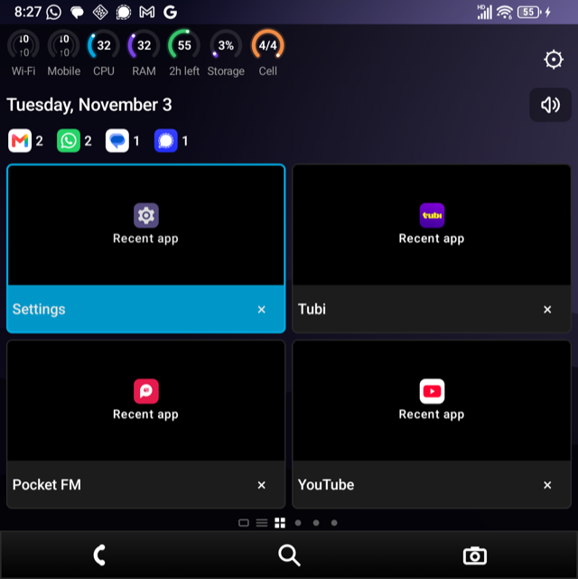
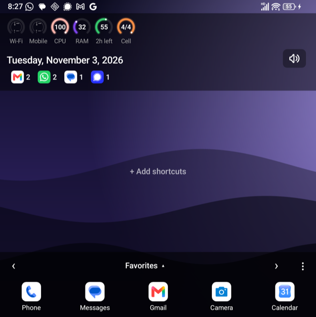
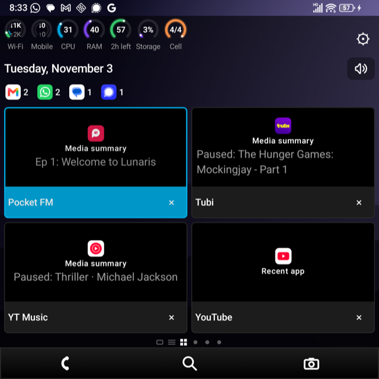
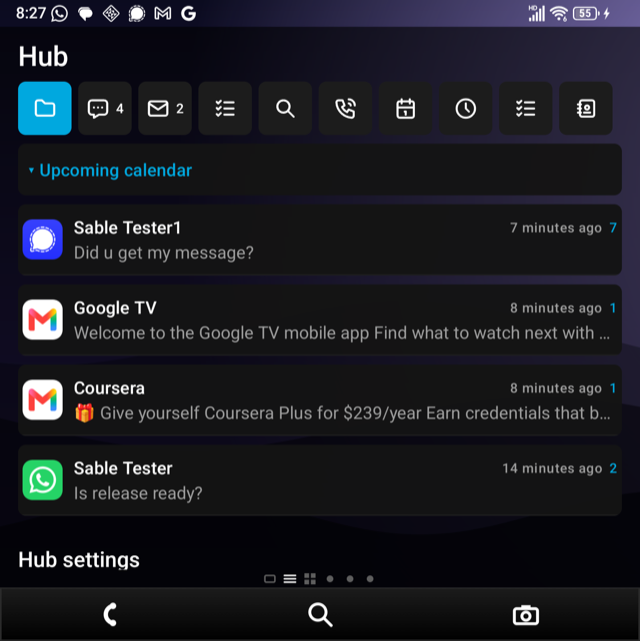
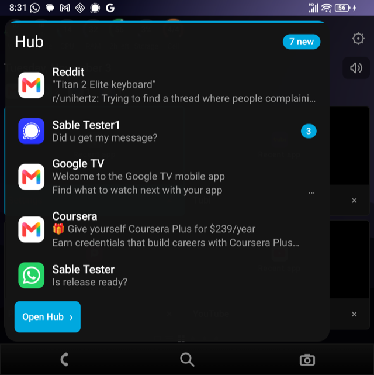
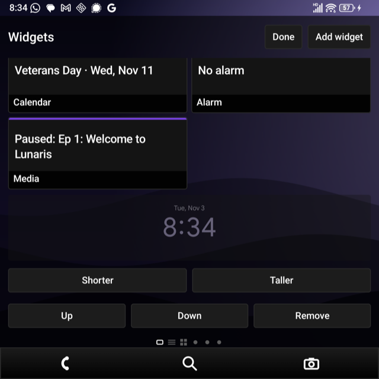

# TenSeven Launcher

[](https://github.com/aimindseye/tenseven-launcher/actions/workflows/android.yml)
[](https://github.com/aimindseye/tenseven-launcher/actions/workflows/checks.yml)
[](https://github.com/aimindseye/tenseven-launcher/actions/workflows/security.yml)
[](https://sonarcloud.io/summary/new_code?id=aimindseye_tenseven-launcher)
[](LICENSE)
[](docs/ARCHITECTURE.md)

Tenseven is a privacy-focused, keyboard-first Android home screen for phones with a physical keyboard.
It gives you two classic layouts to choose from, **a BlackBerry 10 style** (Hub, Active Frames and app
pages) and **a BlackBerry 7 style** (clock and status over a tray of apps), and drives them from the
keyboard and trackpad: type to find an app, hold a letter to jump to it, move with the trackpad. It is an
ordinary app you install and set as your home app; no root and no custom ROM.

The launcher comes from **Sable Start**, the home screen of
[SableOS for the Zinwa Q25](https://github.com/aimindseye/zinwaq25-sableos), rebuilt here as a standalone
Gradle project so it can run on any Android 14+ phone, with new icons
([Tabler](https://github.com/tabler/tabler-icons)) and the missing pieces filled in from
[MinkLauncher OpenSource](https://github.com/katoaapps/openminilaunch).

## TenSeven 2.0 — accepted modular companion architecture (not yet released)

TenSeven 2.0 will keep **one Full Launcher APK** for BBOS7/BBOS10 Home, Hub, Peek, Lock and Active Frames, while moving independent Phone, Calendar, Tasks/Remind, Notes, Calc Plus, Sound Profiles and the ten games into **optional, separately installed APKs** (initially one Games Pack). The Launcher will offer a companion-app installation wizard and optional Complete release ZIP; it will continue working with the user's existing third-party apps.

**This is the approved target, not current functionality.** The 2.0 development branch still bundles these apps in `:app` until migration and Titan 2/CI acceptance are complete. Current 1.0.0 release instructions below remain unchanged.

- [Architecture decision (ADR-0001)](docs/decisions/ADR-0001-MODULAR-COMPANION-APKS.md)
- [Implementation roadmap and immutable gates](docs/2.0/MODULARIZATION_ROADMAP.md)
- [APK/ZIP distribution, installer and migration contract](docs/2.0/COMPANION_DISTRIBUTION.md)
- [PR127 supersession and recovery checkpoint](docs/2.0/PR127_HANDOFF.md)
- [Design-compliance checklist](docs/2.0/DESIGN_COMPLIANCE.md)

## Version 1.0.0

Android 14+ · package `io.github.aimindseye.tenseven` · version code `18`.
[Download TenSeven Launcher 1.0.0](https://github.com/aimindseye/tenseven-launcher/releases/tag/v1.0.0)
on your phone and open the APK to install. The release supports Play Protect scanning;
no ADB installation or computer is needed.
See [release notes](docs/releases/1.0.0.md), [build and publish commands](docs/BUILD.md),
[the user guide](docs/USER_GUIDE.md) and [delivery status](docs/P2_P3_STATUS_20261103.md).

## Functionality

| Area | Available behavior |
|---|---|
| Home layouts | BlackBerry 7 banner/tray and BlackBerry 10 Hub/Active Frames/app pages; responsive grids, keyboard navigation and touch support |
| Command | Type to search, Alt+Space, app/contact/action scopes, letter assignments and usage-ranked results |
| Hub | Conversations, inline reply, unread filtering, snooze, reminders, calls, contacts and selected calendars; ten actions in one row, scrolling on narrow windows |
| Home notifications | Compact or show-all icons for either home style; tapping an app icon opens that app's Hub notifications |
| Active Frames | BB10 only; the last eight opened apps, oldest displaced by a ninth. Available summaries enhance existing cards; background history/notifications do not create cards |
| Summaries | Media sessions, selected calendars, optional Hub message excerpts and TenSeven-owned Notes/Tasks/calculator data. FM/player text depends on exposed notification metadata |
| Office apps | Normal recent-app cards; no file linking or automatic access to private Word/Excel/PowerPoint documents |
| Widgets | Built-in glance cards and hosted Android widgets on the Widgets page; bind/configure, reorder, resize and remove |
| Personalisation | Themes, theme-file import/export, wallpapers, icon/grid choices, configurable dials including storage, backup and restore |
| Extras | Optional Notes, Tasks/Remind, Calc Plus, Sound Profiles and games |
| Lock layer | Optional cover over Android's own secure lock; requires overlay and notification access |
| Device support | Profiles and responsive policies for Titan 2, Titan 2 Slim, Zinwa Q25, Zinwa P26 and touchscreen fallback; Device compatibility includes keyboard diagnostics |

## Permissions and privacy

No root or platform signature is required. The launcher has no Internet permission.
Basic app launching and recent-app cards work without notification access. Enable Android
notification access for TenSeven to use Hub and media/notification summaries. The upcoming
2.0 Hub automatically includes Android-delivered notifications, with optional app filters or
a manual selection in Hub settings. Its action panel uses actions supplied by each notification;
message type alone cannot enable Reply All or Forward. Calendar access and calendar selection are separate.
Usage access helps observe app launches outside the launcher. Work and Private Space data
remain subject to Android's profile boundaries.

Automatic private-app snapshots and force-stop are unavailable to this ordinary install.
User-approved screen capture has a separate Android consent flow and preview. No Office
file access is implied by opening Word, Excel or PowerPoint. See the guide for privacy limits.

If Android blocks notification access after sideloading, open Android Settings → Apps →
TenSeven Launcher → the three-dot menu → Allow restricted settings, when offered by the device,
then enable notification access. OEM wording and availability vary.

## Build and install

Use JDK 17 and Android SDK 36 / build-tools 36.0.0. Release signing is automatic when the existing
registered keystore credentials are configured; do not sign the resulting APK a second time.

```bash
./gradlew :app:assembleDebug
bash tools/build-release.sh
```

The verified release package is `~/Downloads/tenseven-release/1.0.0/TenSeven-Launcher-1.0.0.apk`,
with a SHA-256 checksum and source commit. The old consolidated-test helper delegates to this
release helper. Lite builds are retired. Full setup, Google Play AAB and GitHub publishing:
[BUILD.md](docs/BUILD.md).

## Testing and device qualification

Device-profile and responsive-layout support is available for:

- Unihertz Titan 2
- Unihertz Titan 2 Slim
- Zinwa Q25
- Zinwa P26
- Touchscreen Android phones through a generic device profile

**Unihertz Titan 2 is currently the only device tested on physical hardware.**
The other device profiles still require testing on their respective devices.

## Screenshots and documentation

Screenshots supplied by the owner from TenSeven Launcher 1.0.0 on a Unihertz Titan 2.
Tap a screenshot to view it at full size. The user guide places more captures beside each feature.

| BlackBerry 10 Home | BlackBerry 7 Home | Active Frames with media summaries |
|---|---|---|
| <a href="docs/images/v1.0.0/home-bb10.png"></a> | <a href="docs/images/v1.0.0/home-bb7.png"></a> | <a href="docs/images/v1.0.0/active-frames.png"></a> |


| Hub: one navigation row | Rounded Hub peek | Widget height and order controls |
|---|---|---|
| <a href="docs/images/v1.0.0/hub-page.png"></a> | <a href="docs/images/v1.0.0/hub-peek.png"></a> | <a href="docs/images/v1.0.0/widgets-page-edit.png"></a> |

[Capture and review notes](docs/images/v1.0.0/README.md) distinguish the new images from
older screenshots elsewhere in `docs/images/`. To update them again, use the
[screenshot capture instructions](docs/SCREENSHOTS.md).

- [User guide](docs/USER_GUIDE.md)
- [Architecture](docs/ARCHITECTURE.md)
- [Build and release](docs/BUILD.md)
- [Screenshot tooling](docs/SCREENSHOTS.md)
- [Device qualification](docs/P3_DEVICE_QUALIFICATION.md)
- [Third-party provenance](THIRD_PARTY_NOTICES.md)

## Licence

Apache License 2.0 ([`LICENSE`](LICENSE), [`NOTICE`](NOTICE)). Third-party components keep their own
licences: see [`THIRD_PARTY_NOTICES.md`](THIRD_PARTY_NOTICES.md). The Sable apps' translations
(18 languages) are machine-assisted drafts, not reviewed by fluent speakers; English is the reference
text, and corrections are welcome.

BlackBerry is a trademark of its owner. Tenseven is not affiliated with or endorsed by BlackBerry Limited.

## Credits

- **Sable Start and the Sable design library:** [SableOS for the Zinwa Q25](https://github.com/aimindseye/zinwaq25-sableos).
- **Icons:** [Tabler Icons](https://github.com/tabler/tabler-icons) by Paweł Kuna (MIT).
- **Notification, usage, Private Space, onboarding, icon pack, backup and command ideas and code to port:**
  [MinkLauncher OpenSource](https://github.com/katoaapps/openminilaunch) by Katoa Apps (Apache-2.0).
- **Status rings:** [Titan AI](https://github.com/andrehafner/aiassistant) by Andre Hafner (MIT).
- **BlackBerry 10 interaction and design reference:** **JLauncher (JL10 v0.6)** — credited for the BB10-style Hub, source drawer, navigation, gestures, and Active Frames presentation reviewed for TenSeven 2.0. The author has not provided a public GitHub repository; no JLauncher code, assets, or privileged hooks have been incorporated. See the [JL10 reference review](docs/2.0/JL10_BB10_REFERENCE_REVIEW_20261112.md).
