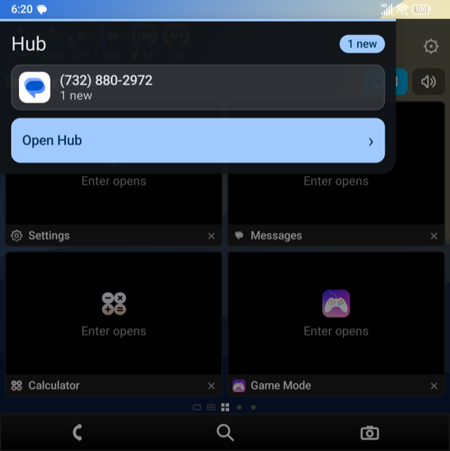
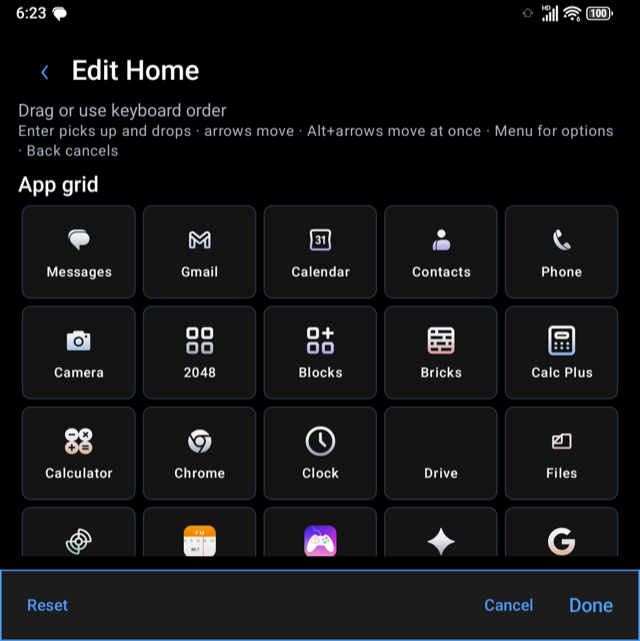
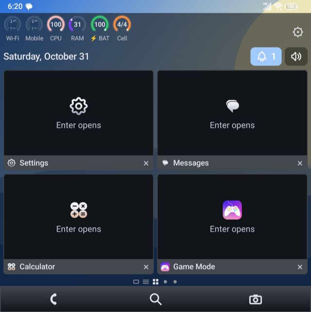

# Tenseven Launcher

[](https://github.com/aimindseye/tenseven-launcher/actions/workflows/android.yml)
[](https://github.com/aimindseye/tenseven-launcher/actions/workflows/checks.yml)
[](https://github.com/aimindseye/tenseven-launcher/actions/workflows/security.yml)
[](https://sonarcloud.io/summary/new_code?id=aimindseye_tenseven-launcher)
[](LICENSE)
[](docs/ARCHITECTURE.md)

Tenseven is a privacy-focused, keyboard-first Android home screen for phones with a physical keyboard.
It gives you two classic layouts to choose from, **a BlackBerry 10 style** (Hub, Active Frames and app
pages) and **a BlackBerry 7 style** (clock and status over a tray of apps), and drives them from the
keyboard and trackpad: type to find an app, hold a letter to jump to it, move with the trackpad. It is an
ordinary app you install and set as your home app; no root and no custom ROM.

The launcher comes from **Sable Start**, the home screen of
[SableOS for the Zinwa Q25](https://github.com/aimindseye/zinwaq25-sableos), rebuilt here as a standalone
Gradle project so it can run on any Android 11+ phone, with new icons
([Tabler](https://github.com/tabler/tabler-icons)) and the missing pieces filled in from
[MinkLauncher OpenSource](https://github.com/katoaapps/openminilaunch).

## Screenshots

From a Unihertz Titan 2. The [user guide](docs/USER_GUIDE.md) shows every screen.

|  |  |  |  |
|---|---|---|---|
|  |  |  |  |
| <sub>Setup</sub> | <sub>Launcher Settings</sub> | <sub>Hub settings</sub> | <sub>Lock layer</sub> |

|  |  |  |  |
|---|---|---|---|
|  |  |  |  |
| <sub>BlackBerry 10 home</sub> | <sub>BlackBerry 7 home</sub> | <sub>Hub</sub> | <sub>Hub peek</sub> |


|  |  |  |
|---|---|---|
|  |  |  |
| <sub>Edit Home</sub> | <sub>Widgets page</sub> | <sub>Phone colours theme</sub> |

## What you get

| | |
|---|---|
| **Launcher Settings** | One screen (BB7 menu, BB10 gear, or Command: "Launcher Settings"): home style (BlackBerry 7 or 10), Type to search, icon grid (columns, rows, icon size, app names, live preview), theme (BlackBerry, Phone colours and six more) and wallpaper (eight, set for Home, Lock or both), Widgets page and Glance widget switches, Hub settings, lock layer, Language, Back up and restore, Setup, Android settings and a privacy note. Every change is saved at once |
| **Setup** | First run and Launcher Settings, then Setup: the home role, each optional permission with its reason, and a step for every Launcher Settings group (style, theme and wallpaper, icon grid, widgets, Hub, lock screen, extra apps). The choice steps share their controls with Launcher Settings, so setup cannot fall behind it |
| **BlackBerry 10 style** | Hub, then Active Frames (cards for the apps you opened recently; empty until you open one), then pages of app icons. Phone, Search and Camera along the bottom. A top row with the status dials, the gear (Launcher Settings), today's date, a bell with the unread count (opens the Hub) and the speaker icon. Up to 8 frames, 5 icons per row |
| **BlackBerry 7 style** | Status dials, date, unread badge and speaker icon over the wallpaper and a tray with Favorites, All and Downloads panels (Frequent, the apps you open most, can be added from the menu). A new home starts with your phone's own Phone, Messages, Mail, Camera, Calendar, Browser, Gallery and Music apps plus Settings. Swipe right for the Hub, left for the apps; long-press empty space, then Add to home screen, to place icons between the banner and the tray; Alt+Left/Right or Space switches panels |
| **BB7 menu** | Alt+Enter, the ⋮ button on the tray or a long-press on an icon (the Titan 2 has no Menu key): add to or remove from the home screen, move, App info, show or hide panels, more rows, clearer or darker banner and tray, change wallpaper, Launcher Settings, Command |
| **Type to find** | Press a letter on Home to search apps and actions; prefixes such as `?app`, `@person`, `/settings`, `!action`, `/private`, `/work` narrow it. Alt+Space opens Command from either layout; swipe down on the BB10 Home does too. Can be switched off in Launcher Settings |
| **Hold a letter** | Hold a key on Home to open the app you assigned to it (`assign k camera` in Command; `unassign k` frees it), or call a speed-dial contact where Sable Phone is installed |
| **Most-used first** | Command ranks the apps you open most ahead of other matches, so two letters are usually enough. Counts stay on the phone and fade over time |
| **All Apps** | A to Z with a privacy row per app (permissions and special access), Private Space and work profile support, uninstall through the system |
| **Widgets page** | Left of Hub, the one place for widgets: the built-in ones you switch on (Calendar, Alarm, Battery, Now playing) first, then widgets from any installed app (a weather app, a clock), added from a picker, ordered with Up/Down, removed in Edit. The BB10 home itself holds only your recent apps. Can be switched off in Launcher Settings |
| **Edit Home** | Reorder the grid, bottom bar and frames with the keyboard; a bar at the bottom (Reset, Cancel, Done) stays on screen |
| **Hub peek and Hub settings** | Drag in from the left edge of the BB10 home (or Space on the Hub slot) for the latest conversations without leaving Home. Hub settings: clear the Hub now, choose which apps feed it, and whether message text may be shown |
| **Themes and wallpapers** | Eight themes that work on an ordinary install (BlackBerry, Phone colours and six more), theme files you can import and export, and eight wallpapers Tenseven draws itself (no image files, no BlackBerry artwork); the BB10 home can show the wallpaper through, dimmed |
| **Lock layer** | Optional BlackBerry-style cover over your lock screen: time, date, app icons with counts, camera shortcut. The phone's own lock stays underneath. Needs Display over other apps and notification access |
| **Hub** | Unread bar, then your message and email conversations grouped per person with inline reply (Tenseven's own notification listener, in memory only, text hidden while locked), calls and contacts. Filter by person, unread, messages or email; mark read (button or `M`); snooze for an hour or until tomorrow (button or `S`). It opens your phone's default Messages, Mail, Phone and Contacts apps and needs no Sable app |
| **Built-in widgets** | Calendar (next event), Alarm (next alarm), Battery and Now Playing, all off until you switch them on in Launcher Settings: cards at the top of the Widgets page, reached by swiping right on BB10 or from the menu on BB7 |
| **Sound** | The speaker icon on both homes shows Sound, Vibrate or Silent. With the Sound Profiles extra on, a tap opens it (a long press switches modes); otherwise a tap cycles Android's own modes, and Silent needs Do Not Disturb access (long press opens that screen) |
| **Mail tile** | The BB10 Mail tile shows the newest unread email from your notifications (text hidden while locked) and opens your default email app |
| **Edit Home** | Reorder the grid, the bottom bar and the frames with the keyboard (Enter picks up and drops, arrows move) |
| **Extra apps** | Optional Calc Plus (exact and scientific calculator with unit converter; named so it does not clash with the phone's own Calculator), Notes, Sound Profiles (the BlackBerry profiles: Normal, Loud, Vibrate only, Phone calls only, All alerts off, each with volume, tones, vibration and light; needs Do Not Disturb access and, for tones and vibration, Modify system settings) and ten games (Sudoku, Minesweeper, 2048, Bricks, Snake, Blocks, Reversi, Solitaire, Mahjong, Words). None is on by default: tick the ones you want in the setup's Extras step, or later from Command, Extra apps. Nothing is downloaded; they ship inside Tenseven. In every extra, Esc leaves and Menu lists its keys |
| **Default apps** | Tiles and shortcuts open your phone's own Calendar, Music, Email, Gallery, Messages, Phone and Camera apps, found by Android's app categories; next event and now-playing come from Android. There is no weather tile: Android has no weather data API and Tenseven asks for no internet access |
| **Back up** | Launcher Settings, Back up and restore: a readable JSON file through the system file picker (no storage permission); letter shortcuts and contacts are not included |

Keyboard shortcuts are confirmed on the Titan 2 only where noted in [`docs/USER_GUIDE.md`](docs/USER_GUIDE.md); the repo
records which keys each phone sends in `docs/ARCHITECTURE.md` as they are measured.

## Privacy and permissions

Tenseven has no accounts, ads, analytics, trackers or servers, and does not use the internet.
Launcher state is in app-private storage. Recent activity is kept in memory only.

| Permission | Why | Optional |
|---|---|---|
| Home app role | Be the home screen | needed to be a launcher |
| `READ_CONTACTS` | Hub Contacts tab: names and one number per person, read on the phone, never stored | yes; the tab asks again |
| `READ_MEDIA_IMAGES` | Local photo counts on Home | yes |
| `READ_CALENDAR` | The next event on the Calendar widget | yes; the widget asks again |
| `REQUEST_DELETE_PACKAGES` | Hand uninstall to the system uninstaller, which confirms | yes |
| Usage access (a special access you grant in Settings) | Active Frames also lists apps you opened without Tenseven (names and times only; not stored or sent) | yes; off until you turn it on |
| Notification access (a special access you grant in Settings, not a manifest permission) | Counts unread messages and email per app for the Hub bar, grouped per person; read on the phone, held in memory only, never stored or sent | yes; off until you turn it on |
| Accessibility service "Tenseven double-tap to lock" (a special access you grant in Settings) | Double-tap empty Home space to lock the screen. It can only perform the lock action: it reads no screen content and receives no events | yes; off until you turn it on in Accessibility settings and in Appearance |
| `SYSTEM_ALERT_WINDOW` (Display over other apps, granted in Settings) | Only for the optional lock layer: lets it appear over the lock screen when the screen wakes. The phone's own lock stays underneath | yes; off until you turn the lock layer on |
| `SET_WALLPAPER` | Sets one of Tenseven's own wallpapers when you pick one | yes; a normal permission, used only when you choose |
| `ACCESS_NOTIFICATION_POLICY` (Do Not Disturb access, granted in Settings) | Lets the speaker icon and Sound Profiles pick Silent and the quiet profiles | yes; needed only for those |
| `WRITE_SETTINGS` (Modify system settings, granted in Settings) | Sound Profiles sets tones, vibration and the notification light | yes; only the Sound Profiles extra uses it |
| `ACCESS_HIDDEN_PROFILES` | Show the Private Space; Android grants it to the default Home app only | yes |

No signature permissions: an ordinary install cannot hold them, and CI fails if the manifest asks for one
(`tests/run.sh`). Features that need them on SableOS (live thumbnails in Active Frames, closing tasks,
work-profile privacy rows) have an ordinary-install fallback; see the table in
[`docs/ARCHITECTURE.md`](docs/ARCHITECTURE.md). Notification access is used by the Mink-based Hub (unread bar, conversations per person, inline reply) and
usage access by the recent-apps row on Active Frames. Neither is asked for silently: the setup screen
(first run, and Setup and permissions in the menu) explains each one, and every optional step can be skipped.

### If Android greys out Usage or Notification access

Android 13+ restricts these for apps installed from a file, and some phones (the Titan 2 included) have no menu in App info to lift it. From a computer with adb, replace the id with `io.github.aimindseye.tenseven` (release) or `io.github.aimindseye.tenseven.debug`:

```
adb shell appops set --user 0 <id> GET_USAGE_STATS allow
adb shell cmd notification allow_listener <id>/io.github.aimindseye.tenseven.conversations.ConversationListenerService
```

## Install

There is no published release yet; build one yourself (signed, see [`docs/BUILD.md`](docs/BUILD.md)) or use a CI debug build. With an APK:

1. Download the APK from the GitHub release and open it; approve installing from that source if Android asks.
2. Press Home and choose **Tenseven** as the home app (or Settings > Apps > Default apps > Home app).
3. Follow the setup screens that open on first run: the home role first, then each optional permission with its reason, then your choices (home style, theme and wallpaper, icon grid, widgets, Hub, lock screen, extra apps). All of it can be changed later in Launcher Settings, then Setup.
4. Open Launcher Settings (BB7 menu, BB10 gear, or type "Launcher Settings" in Command) and pick the BlackBerry 10 or BlackBerry 7 card.
5. **Notification or usage access on Android 13 or newer:** Android greys these switches out for apps
   installed outside a store until you open Settings > Apps > Tenseven, tap the top-right menu and choose
   **Allow restricted settings**. The setup screen shows this step when it applies. Only do this for an APK you trust.

To try the current debug build, download `tenseven-debug-apk` from a green run of the
[Android workflow](https://github.com/aimindseye/tenseven-launcher/actions/workflows/android.yml) (it
installs next to a future release as `io.github.aimindseye.tenseven.debug`).

## Supported devices

Tenseven needs Android 11 or newer. A physical keyboard is the point, but nothing stops it running on a
touch-only phone.

| Device | Keyboard | Status |
|---|---|---|
| Zinwa Q25 (SableOS or stock Android) | QWERTY, trackpad | Layouts designed for it; not yet run |
| Unihertz Titan 2 | QWERTY, trackpad; no Menu key (use Alt+Enter) | Debug build runs and is tried by hand; not every feature confirmed |
| Unihertz Titan Pocket | QWERTY | Not yet run |
| BlackBerry KEY2, KEYone | QWERTY | Not yet run |
| Any other Android 11+ phone | on-screen or Bluetooth keyboard | Not yet run |

To add a device, capture its keys with the event viewer in Sable Keyboard (`KeyProbeActivity`) or
`adb shell getevent -lt`, and add the result to the key map in
[`docs/ARCHITECTURE.md`](docs/ARCHITECTURE.md#key-profiles).

## Guides

| Guide | What it covers |
|---|---|
| [User guide](docs/USER_GUIDE.md) | Setting up, both layouts, icon grid, themes and wallpapers, keys and gestures, Command, Hub and peek, widgets, lock layer, extras, sound, grants over adb, troubleshooting |
| [Screenshots](docs/SCREENSHOTS.md) | `tools/take-screenshots.sh`: captures the setup steps, Launcher Settings and the home screens from a connected phone |
| [Roadmap](ROADMAP.md) | What is done, what is next, and what is not planned |
| [Architecture](docs/ARCHITECTURE.md) | Modules, how the imported sources are organised, platform-only features and their fallbacks, key profiles, the keyboard companion |
| [Build](docs/BUILD.md) | Build and test locally, quality switch, lock files, SonarCloud setup, GitHub Actions |
| [Brand assets](docs/BRAND_ASSETS.md) | How provider logos for messaging and AI apps are handled and recorded |
| [Sources](docs/SOURCES.md) | Every upstream with its pin and licence, and every change made to imported files |
| [Porting from Mink](third_party/minklauncher/PORTING.md) | Which MinkLauncher pieces go where, in what order |
| [Contributing](CONTRIBUTING.md) | Workflow, attribution rules, what a pull request needs |
| [Security](SECURITY.md) | How to report a vulnerability |

## Build it yourself

You need JDK 17 and the Android SDK with platform 36 and build-tools 36.0.0. Nothing else.

```bash
git clone https://github.com/aimindseye/tenseven-launcher
cd tenseven-launcher
export ANDROID_HOME=/path/to/android-sdk
./gradlew :app:assembleDebug                 # app/build/outputs/apk/debug/
./gradlew :design:testDebugUnitTest :app:testDebugUnitTest
bash tests/run.sh                            # static checks, no SDK needed
adb install -r app/build/outputs/apk/debug/Tenseven-Launcher-debug.apk
```

Details, the quality switch and the lock files: [`docs/BUILD.md`](docs/BUILD.md).

## Repository layout

```text
app/                      the launcher (Gradle application module, io.github.aimindseye.tenseven)
  src/main/java/io/github/aimindseye/tenseven/   Sable Start sources, imported (renamed from org.sableos.start), plus Tenseven's own code:
    conversations/ iconpacks/ onboarding/        ports from MinkLauncher
    extras/                                      Calc Plus, Notes, Sound Profiles, ten games (from SableOS)
    LauncherSettingsActivity, SettingsSections   Launcher Settings and the setting groups it shares with Setup
    HubSettingsActivity, LockLayerActivity       Hub settings and the lock layer cover
    BackupActivity, OnboardingActivity           Backup and Setup
  src/main/res/                    strings (18 draft translations for the imported text; Tenseven's own lines are English), theme, Tenseven launcher icon
  src/test/                        58 unit-test files (Sable Start's, the ports', and Tenseven's own)
design/                   Sable design library (theme, tokens, shared components, 18 draft translations)
config/                   detekt rules (byte-exact SableOS copy) and their provenance
gradle/                   version catalog and wrapper
third_party/
  tabler-icons/           verbatim SVGs, licence, manifest with sha256, provenance
  minklauncher/           read-only reference snapshot of the MinkLauncher pieces to port, with attribution
  titan-ai/               MIT notice for the status rings
brand-assets/             catalog of messaging and AI provider logos (source, status, sha256)
tools/                    tabler_icons.py, brand_assets.py, refresh-locks.sh, take-screenshots.sh
tests/run.sh              static checks: shellcheck, XML, generated icons, catalog, manifest permissions
docs/                     guides
.github/workflows/        GitHub Actions: checks, Android, Security, CodeQL, SonarCloud
sonar-project.properties  SonarCloud analysis scope
```

## Continuous integration

GitHub Actions runs on every pull request and on `main`, with the same pinned actions SableOS uses:

| Workflow | What it runs |
|---|---|
| `checks` | `tests/run.sh`: shellcheck, XML well-formedness, Tabler icon manifest and generated files, brand catalog, detekt config provenance, licences and provenance of `third_party/`, no signature permissions in the manifest, no keys or APKs tracked, Gradle wrapper checksum |
| `Android` | Gradle build of the debug APK, unit tests, Android Lint, detekt, ktlint and Kover coverage (a baseline, no threshold); uploads the APK and the reports |
| `Security` | Gitleaks history scan and MobSF source scan (also weekly) |
| `CodeQL` | GitHub code scanning for Kotlin (security-and-quality queries; also weekly); results under Security > Code scanning |
| `SonarCloud` | SonarCloud scan of the whole repository, waiting on the "Sonar way" quality gate; needs the `SONAR_TOKEN` repository secret |

`Android` and `checks` skip documentation-only changes. SonarCloud runs as CI-based analysis, so
Automatic Analysis must stay off in the SonarCloud project. Until the imported sources are clean,
detekt, ktlint and Lint **report without failing**; compile errors and failing tests always fail. Set the
repository variable `TENSEVEN_STRICT_QUALITY` to `true` to make them fail
([`docs/BUILD.md`](docs/BUILD.md#quality-gates)).

## Boundaries

This repository must never contain signing keys, keystores, device identifiers, personal data, or
proprietary artwork or fonts. BlackBerry's own icons, wallpapers, fonts and apps are not used and not
planned: Tenseven's two layouts are original code that borrows the *arrangement* of the BlackBerry 10
and 7 home screens, nothing else. Provider logos for other companies' apps follow
[`docs/BRAND_ASSETS.md`](docs/BRAND_ASSETS.md).

## Licence

Apache License 2.0 ([`LICENSE`](LICENSE), [`NOTICE`](NOTICE)). Third-party components keep their own
licences: see [`THIRD_PARTY_NOTICES.md`](THIRD_PARTY_NOTICES.md). The Sable apps' translations
(18 languages) are machine-assisted drafts, not reviewed by fluent speakers; English is the reference
text, and corrections are welcome.

BlackBerry is a trademark of its owner. Tenseven is not affiliated with or endorsed by BlackBerry Limited.

## Credits

- **Sable Start and the Sable design library:** [SableOS for the Zinwa Q25](https://github.com/aimindseye/zinwaq25-sableos).
- **Icons:** [Tabler Icons](https://github.com/tabler/tabler-icons) by Paweł Kuna (MIT).
- **Notification, usage, Private Space, onboarding, icon pack, backup and command ideas and code to port:**
  [MinkLauncher OpenSource](https://github.com/katoaapps/openminilaunch) by Katoa Apps (Apache-2.0).
- **Status rings:** [Titan AI](https://github.com/andrehafner/aiassistant) by Andre Hafner (MIT).

## Status

**Working beta.** The launcher builds in CI (compile, 58 unit-test files, Lint, detekt, ktlint, security scans)
and is installed and tried by hand on a Unihertz Titan 2. There is no published release; builds are the CI debug
APK or one you sign yourself. The layouts were designed for the Zinwa Q25's 411 dp square screen, so other screens
need checking. What is done and what is next: [`ROADMAP.md`](ROADMAP.md).

| Area | State |
|---|---|
| Both home layouts, Command, Hub, All Apps, extra apps | Run on the Titan 2 |
| Launcher Settings, Setup (first run and overview) | Run on the Titan 2 |
| Themes, wallpapers (Home, Lock, BB10 see-through), lock layer and its preview | Run on the Titan 2 |
| Widgets page and widget tiles, Hub peek, Hub settings, icon grid options, Edit Home bar | Written and in CI; not yet confirmed on a phone |
| Other devices (Q25, Titan Pocket, KEY2, plain phones) | Not run |

```text
APP=Tenseven Launcher (io.github.aimindseye.tenseven)
PHASE=beta: both layouts, Hub, Command, extras, Launcher Settings, Setup, themes, wallpapers and lock layer built
BASE=Android 11+ (minSdk 30), compileSdk and targetSdk 36, ordinary install, no platform signature
HOME_STYLES=BlackBerry 10 style, BlackBerry 7 style (chosen in Launcher Settings or Setup)
ICONS=Tabler Icons outline 3.50.0 (MIT), generated into the app by tools/tabler_icons.py
WALLPAPERS=eight, drawn in code by Tenseven; no image files, no BlackBerry artwork
APPS_BUILD=GitHub Actions on every pull request (Gradle build, unit tests, Lint, detekt, ktlint, Kover)
DEVICE_TESTED=Unihertz Titan 2, debug build, by hand; no other device
QUALITY_GATES=report only until TENSEVEN_STRICT_QUALITY=true (docs/BUILD.md)
BORROWED_FROM_MINK=Hub conversations, onboarding, usage recents, icon packs, backup, command prefixes, lock service (third_party/minklauncher/PORTING.md)
EXTRAS=Calc Plus, Notes, Sound Profiles, ten games, ported from SableOS, off by default
SABLE_KEYBOARD=separate companion app, not in this repository yet (docs/ARCHITECTURE.md)
RELEASES=none published; release signing supported (docs/BUILD.md)
INTERNET=none (no INTERNET permission)
```
