# User guide

Tenseven is a launcher for phones with a physical keyboard. Screenshots are from a Unihertz Titan 2 on 31 October 2026. This guide covers what you see and what the keys do. It describes a beta: only the Unihertz Titan 2 has been tried by hand, and the newest features have had the least testing.

## First run

1. Install the APK and press Home. Choose **Tenseven** and **Always**.
2. The setup screens ask for each optional permission and say why, and offer every choice Launcher Settings has: home screen style, theme and wallpaper, icon grid, widgets, Hub, lock screen and the extra apps. Every step can be skipped; the launcher works without them. The choice steps use the same controls as Launcher Settings and save as you tap.
3. If Android greys out a permission after a sideload, open Android's app info for Tenseven, tap the three dots, and choose **Allow restricted settings**. Setup explains this when it matters.

|  |  |  |  |
|---|---|---|---|
|  |  |  |  |
| <sub>Home app</sub> | <sub>Home screen style</sub> | <sub>Contacts</sub> | <sub>Photo counts</sub> |

|  |  |  |  |
|---|---|---|---|
|  |  |  |  |
| <sub>Notification access</sub> | <sub>Usage access</sub> | <sub>Theme and wallpaper</sub> | <sub>Wallpapers</sub> |

|  |  |  |  |
|---|---|---|---|
|  |  |  |  |
| <sub>Icon grid</sub> | <sub>Icon grid, more</sub> | <sub>Widgets</sub> | <sub>Hub</sub> |

|  |  |  |  |
|---|---|---|---|
|  | 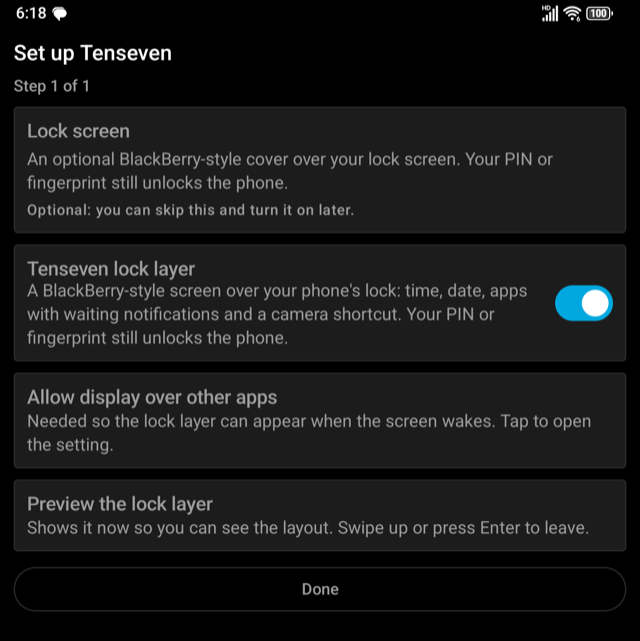 |  |  |
| <sub>Lock screen</sub> | <sub>Lock screen, more</sub> | <sub>Extra apps</sub> | <sub>Extra apps, more</sub> |

## Changing setup later

Launcher Settings, then **Setup**, lists every choice with its state: home app, home screen style, contacts, photo counts, notification access, usage access, theme and wallpaper, icon grid, widgets, Hub, lock screen and the extra apps. **Change** opens the place where Android lets you switch it off or change it; extra apps are ticked or unticked on the same screen and saved. A button there opens Launcher Settings.

|  |  |  |  |
|---|---|---|---|
|  |  |  |  |
| <sub>Setup overview 1 of 9</sub> | <sub>Setup overview 2 of 9</sub> | <sub>Setup overview 3 of 9</sub> | <sub>Setup overview 4 of 9</sub> |

|  |  |  |  |
|---|---|---|---|
|  |  |  |  |
| <sub>Setup overview 5 of 9</sub> | <sub>Setup overview 6 of 9</sub> | <sub>Setup overview 7 of 9</sub> | <sub>Setup overview 8 of 9</sub> |

|  |
|---|
|  |
| <sub>Setup overview 9 of 9</sub> |

## Choosing a home screen

Open **Launcher Settings** (BlackBerry 10: the gear icon; BlackBerry 7: menu, then Launcher Settings; or type "launcher settings" in Command). Pick:

- **BlackBerry 10**: a column of live tiles, with Hub one swipe to the right.
- **BlackBerry 7**: a see-through banner and tray over your wallpaper, and a grid of icons.

You can change your mind any time. Settings are saved as you tap.

|  |  |  |  |
|---|---|---|---|
|  |  |  |  |
| <sub>Home style chooser</sub> | <sub>Launcher Settings 1 of 6</sub> | <sub>Launcher Settings 2 of 6</sub> | <sub>Launcher Settings 3 of 6</sub> |

|  |  |  |
|---|---|---|
|  |  |  |
| <sub>Launcher Settings 4 of 6</sub> | <sub>Launcher Settings 5 of 6</sub> | <sub>Launcher Settings 6 of 6</sub> |

## BlackBerry 7 home

- **Tray panels**: Favorites, All, Downloads, and Frequent (the apps you open most). Add Frequent from the menu.
- **Icons on the home screen**: the empty space between the banner and the tray holds the icons you put there. Long-press empty space (or menu, then **Add apps to the home screen**) to open All, then long-press an app and choose **Add to home screen**. Long-press a placed icon for **Move** or **Remove from home screen**. Arrow Up from the tray's first row moves into them; Down returns.
- **Favorites** are separate: the tray's first panel. Use **Add to Favorites** / **Remove from Favorites** in an app's menu.
- **Menu**: there is no Menu key on the Titan 2, so use **Alt+Enter**, the ⋮ button, or a long-press.
- **No widgets on this home**: the built-in widgets and any widgets you add live on the Widgets page (menu, then Widgets).
- **Icon size and columns**: Small, Medium or Large, and Auto or 3 to 6 columns, in Launcher Settings (the same settings size the BlackBerry 10 app grid).
- **Command and Hub** open as BlackBerry 10 views and bring you back to BlackBerry 7 when you leave them.

|  |  |  |  |
|---|---|---|---|
|  |  |  |  |
| <sub>BlackBerry 7 home</sub> | <sub>Menu</sub> | <sub>Icons on the home screen</sub> | <sub>All panel</sub> |

|  |  |
|---|---|
| 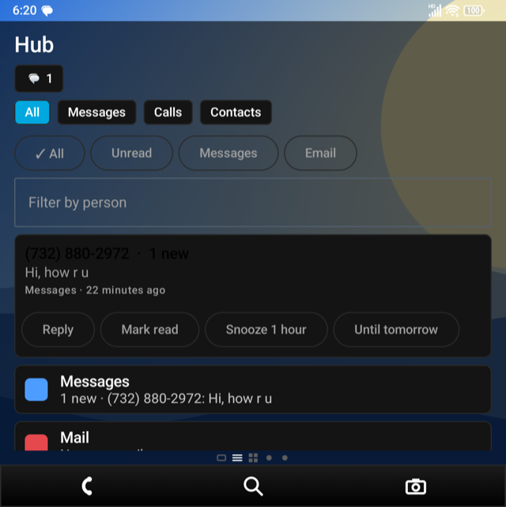 |  |
| <sub>Hub (swipe right)</sub> | <sub>Apps (swipe left)</sub> |

Launcher Settings with BlackBerry 7 chosen. The BlackBerry 7 options (panels, rows, banner and tray darkness) show only while BlackBerry 7 is the home style:

|  |  |  |  |
|---|---|---|---|
| 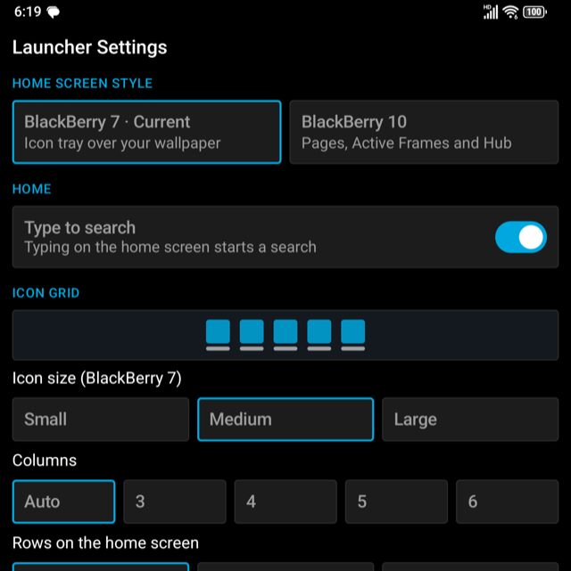 | 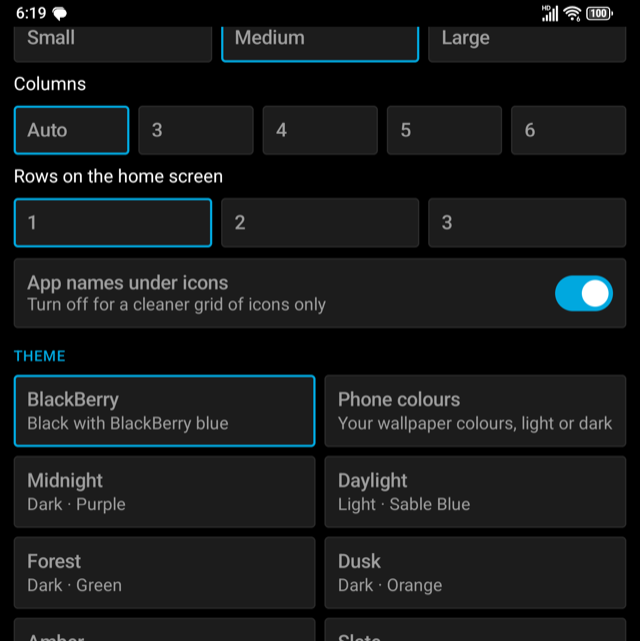 | 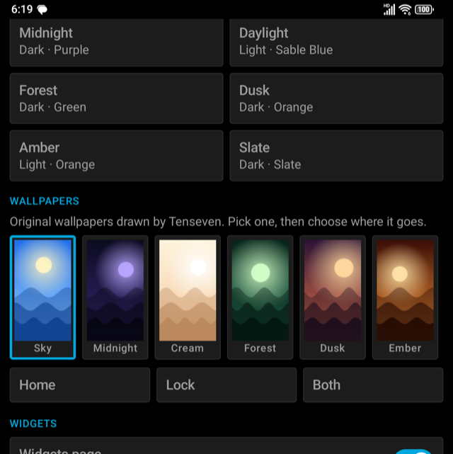 | 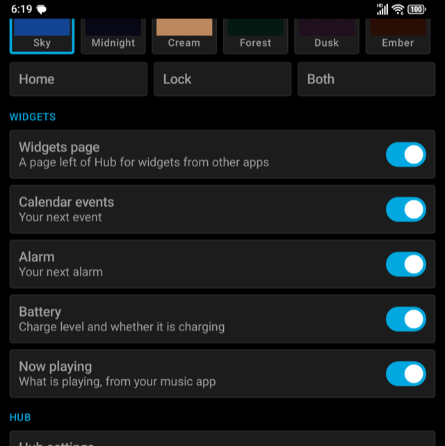 |
| <sub>BlackBerry 7 settings 1 of 6</sub> | <sub>BlackBerry 7 settings 2 of 6</sub> | <sub>BlackBerry 7 settings 3 of 6</sub> | <sub>BlackBerry 7 settings 4 of 6</sub> |

|  |  |
|---|---|
| 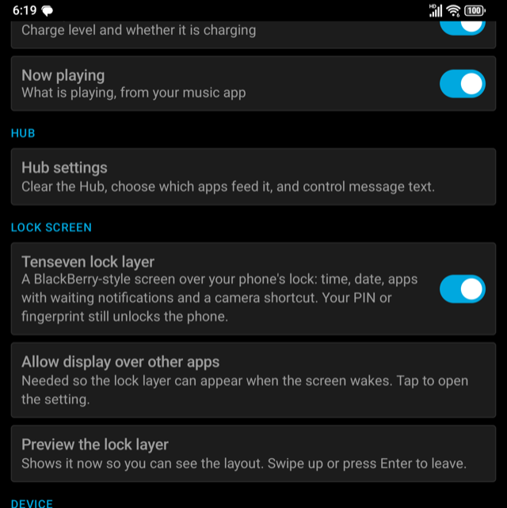 | 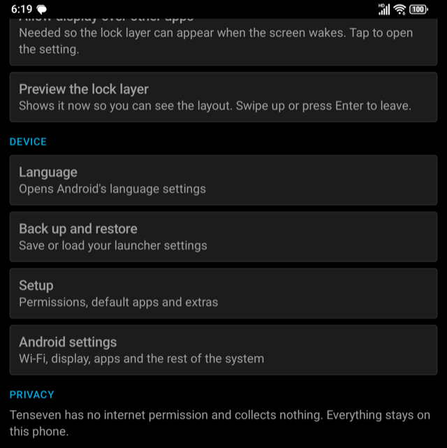 |
| <sub>BlackBerry 7 settings 5 of 6</sub> | <sub>BlackBerry 7 settings 6 of 6</sub> |

## BlackBerry 10 home

**Active Frames** show the apps you opened recently, newest first, up to eight cards in two columns, each with the app's icon and name. Press Enter or tap to open one; the **×**, a long-press, or the X or Backspace key hides that card until you open the app again. Apps you start from Tenseven appear at once, until the phone restarts; with usage access, apps you opened another way (from a notification, say) appear too, if they stayed in front for a couple of seconds in the last 12 hours and since the phone last started (nothing carries over a restart); a permission prompt or picker that another app flashes up does not count. Android only lets the phone's built-in home screen show other apps' live pictures, so on an ordinary install the cards are icons, not live pictures. Until you have opened an app the home is empty: widgets live on the Widgets page, not here. Swipe down for Command, swipe right for Hub.

|  |  |  |  |
|---|---|---|---|
|  |  | 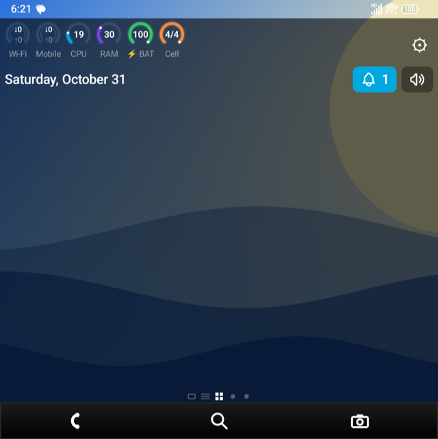 |  |
| <sub>BlackBerry 10 home</sub> | <sub>Active Frames</sub> | <sub>Nothing open yet</sub> | <sub>Hub (swipe right)</sub> |

|  |
|---|
|  |
| <sub>App pages (swipe left)</sub> |

|  |
|---|
|  |
| <sub>App pages (swipe left)</sub> |

## Widgets page

Swipe right past Hub (or Alt+Left twice from Home) to the Widgets page. The built-in widgets you switched on in Launcher Settings (Calendar, Alarm, Battery, Now playing) sit at the top as cards; all of them are off until you switch them on. Below them are widgets from other apps, such as a weather app, in one scrolling column.

- **Add widget** lists the widgets of every installed app. Android asks once to allow Tenseven to hold a widget, and some widgets show their own setup screen first (a weather city, say).
- **Edit** dims each added widget and puts Up, Down and Remove in a row under it. Widgets take touches themselves, so the controls only appear in Edit.
- **BlackBerry 7**: menu, then Widgets. Back returns to BlackBerry 7.
- The page can be switched off in Launcher Settings. Widget choices belong to the phone and are not in a backup.
- Widgets are drawn by their own apps, so they will not match Tenseven's look, and controls inside them are touch-only.

|  |  |  |
|---|---|---|
|  |  |  |
| <sub>Widgets page</sub> | <sub>With a widget</sub> | <sub>Edit: Up, Down, Remove</sub> |

## Icon grid, themes and wallpapers

Launcher Settings, **Icon grid**: choose Auto or 3 to 6 columns, the icon size (Small, Medium or Large), and whether app names show under icons. These apply to both home styles: the BlackBerry 10 app grid pages and the BlackBerry 7 home and tray. On a narrow or small screen such as the Titan 2 Slim, pick fewer columns or Small icons if the grid feels cramped; Auto already uses fewer columns when the screen is narrow, and the app grid fits the rows to the icon size. Rows (1 to 3) and the small preview that changes as you choose appear only while **BlackBerry 7** is the home screen style, and the **wallpaper behind the home** switch appears only for BlackBerry 10. (Ripe's separate "tile width" is the same choice here: the number of columns sets the width.)

**Theme** has eight looks. **BlackBerry** is the default: pure black with the BlackBerry blue, on the launcher and on the built-in apps (Calc Plus, Notes, Sound Profiles, the games). **Phone colours** follows your wallpaper colours and the phone's light or dark setting (Android 12 or newer; older versions show the BlackBerry blue). The rest are Midnight, Daylight, Forest, Dusk, Amber and Slate. They work on an ordinary install and are saved with a backup. Android has no way to install other apps' themes into a launcher; you can import a theme file (see **Theme files** below). **Wallpapers** has eight pictures Tenseven draws itself, with no outside artwork: pick one, then choose **Home**, **Lock** or **Both**.

The launcher in the Phone colours theme:

|  |  |  |
|---|---|---|
|  | 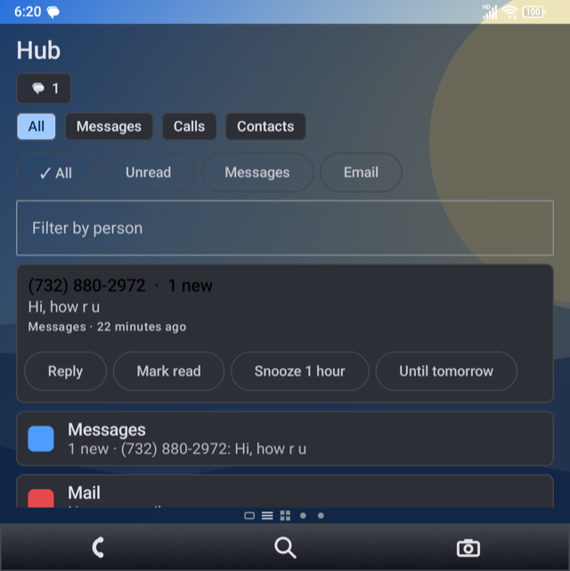 | 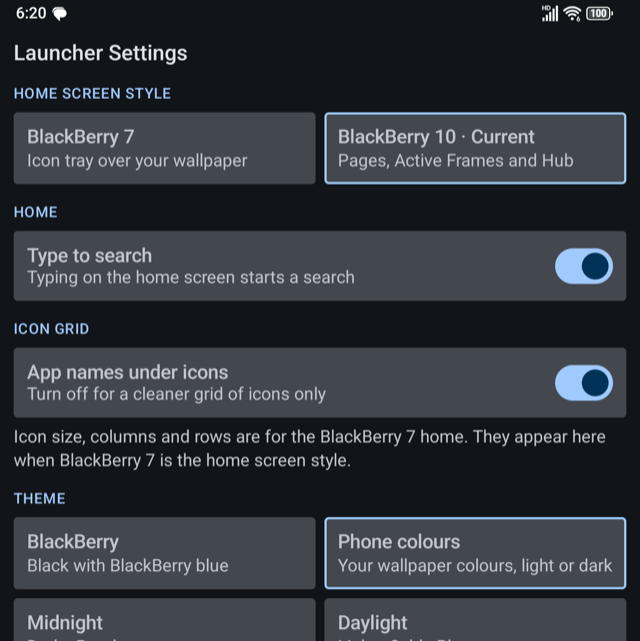 |
| <sub>Phone colours: home</sub> | <sub>Phone colours: Hub</sub> | <sub>Phone colours: Launcher Settings</sub> |

## Hub settings and the Hub peek

Launcher Settings, **Hub settings** (also the Hub's own settings button): **Clear the Hub now** forgets everything the Hub holds, **Apps in the Hub** turns individual apps off so their notifications stay out of the Hub, the peek and the lock layer, and **Show message text** decides whether the latest message may appear on the peek and the lock layer (off: names and counts only). Nothing is stored.

**Peek**: always drawn in the phone's own colours (your wallpaper colours and light or dark), whatever launcher theme you chose, and slightly see-through, so Home shows faintly behind it. On the BlackBerry 10 home, drag in from the very left edge to slide the latest conversations over Home. Tap one to open it in its app, **Open Hub** for the full page, Back or Escape to close. Space on the Hub slot of the bottom bar does the same, and works with any navigation style. The drag only works on the Home page, and with Android gesture navigation it must start in the strip of the left edge about halfway down the screen: Android keeps the rest of that edge for its own Back gesture (a small "<" arrow appears instead).

|  |  |  |  |
|---|---|---|---|
|  |  |  |  |
| <sub>Hub settings 1 of 8</sub> | <sub>Hub settings 2 of 8</sub> | <sub>Hub settings 3 of 8</sub> | <sub>Hub settings 4 of 8</sub> |

|  |  |  |  |
|---|---|---|---|
|  |  |  | 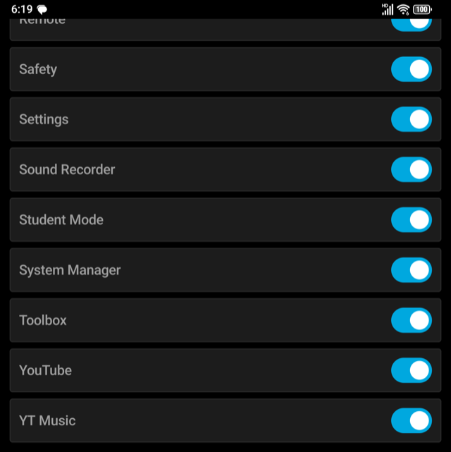 |
| <sub>Hub settings 5 of 8</sub> | <sub>Hub settings 6 of 8</sub> | <sub>Hub settings 7 of 8</sub> | <sub>Hub settings 8 of 8</sub> |


**The peek** slides in from the left edge over Home, in the phone's own colours:

|  |
|---|
|  |
| <sub>Hub peek</sub> |

## Edit Home

Edit Home orders the app grid and the bottom bar and chooses which parts of the home show (the status dials, the date, the search row). It ends in a bar that stays on screen: **Reset**, **Cancel**, **Done**. Open it by long-pressing an empty spot on the app pages, long-pressing a bottom-bar slot, or typing `edit home` in Command.

|  |
|---|
|  |
| <sub>Edit Home with its bottom bar</sub> |

## Lock layer

Launcher Settings, **Lock screen** (also a Setup step), switch on **Tenseven lock layer**. When the screen wakes onto your lock screen, Tenseven shows a BlackBerry-style cover: the time, the date, an icon with a count for each app with waiting notifications, and a camera shortcut. It is only a cover: swipe up, press Enter or Space, or tap an app, and Android asks for your PIN, pattern or fingerprint before anything opens. The camera opens the secure camera without unlocking.

It needs two permissions, both explained in Settings: **Display over other apps** (so it can appear when the screen wakes) and **Notification access** (for the counts; message text only if Hub settings allow it). Some Android versions refuse to start a screen from the background; if the layer does not appear, switch it off.

|  |  |
|---|---|
|  |  |
| <sub>Preview</sub> | <sub>On a real lock screen</sub> |

## Finding things

- **All Apps privacy detail**: in All Apps, move to an app and press **Space** to open its permissions and special access (Space again closes it). The same works in Peek.
- **Appearance**: type `appearance` in Command, or scroll to the bottom of Edit Home and tap **appearance**. It sets the theme and accent; Launcher Settings, Theme has the ready-made looks.

- **Type on Home** to search apps. It can be turned off in Launcher Settings. **Alt+Space** opens Command from either layout.
- **Hold a letter** to open the app or contact assigned to it. In Command, `assign` and `unassign` set letters. Without an assignment, the most-used app starting with that letter comes first.
- **Command prefixes**: `-` makes a to-do, `/` a note, `+` an event, a web address opens the browser, and `?`, `@`, `#`, `!` and `/settings`-style words narrow the search. To-dos and notes go to an app you pick; Tenseven stores none. See the [table below](#command-prefixes).

|  |  |  |  |
|---|---|---|---|
|  |  |  |  |
| <sub>Command</sub> | <sub>All Apps</sub> | <sub>App privacy detail (Space)</sub> | <sub>Appearance</sub> |

### Command prefixes

Type the prefix first, with nothing before it, then your text. Each one shows as a row in Command; press Enter on the row to run it. The first three are the quick
actions that came from the MinkLauncher Magic Box; the rest narrow the search and are Tenseven's own.

| Type | What it does | Example |
|---|---|---|
| `-text` | Shows a to-do row; Enter opens Android's "send to" list so you pick the app that keeps it. Tenseven keeps nothing | `-Buy milk` |
| `/text` | Shows a note row; Enter sends the text to the app you pick the same way | `/Draft the release notes` |
| `+text` | Shows an event row; Enter opens your calendar's new-event screen with that title | `+Dinner Friday at 7` |
| A web address | Shows an open-address row; Enter opens it in the browser (`https://` is added when missing) | `example.com/page`, `www.example.org` |
| `?name` | Searches apps only | `?cam` |
| `@name` or `#name` | Searches people only | `@alex` |
| `!action` | Searches actions only | `!` then the first letters of an action |
| `/settings text` | Searches Settings only | `/settings wifi` |
| `/apps text` | Apps only, the same as `?` | `/apps clock` |
| `/hub text` | Searches the Hub only | `/hub invoice` |
| `/private`, `/dual`, `/work` | Lists the apps of one profile: Private Space, Dual (cloned) apps, or the work profile | `/work mail` |
| A phone number | Shows a call row; Enter opens the dialer with the number (it does not dial for you). Its menu also offers a message and Add to contacts. Needs three digits or more | `917 555 0100` |

- A `/` that starts one of the scope words (`settings`, `apps`, `hub`, `private`, `dual`, `work`) is that scope, not a
  note. To write a note that starts with one of those words, put something else first.
- A prefix with nothing after it does nothing yet; keep typing.
- A number that starts with `+` is read as an event, so type it without the plus (or use `#` first).
- Without a prefix, Command searches everything: apps, people, Settings and actions, with the apps you open most first.
- Not included from Mink: the `*` prefix for AI. Tenseven has no network access.

## Hub

Messages and mail notifications grouped by person, with inline reply where the app allows it. It reads notifications (needs notification access), keeps them in memory only, and clears them when the launcher stops. Filters, mark read and snooze are in the Hub bar.

|  |
|---|
|  |
| <sub>Hub</sub> |

## Sound

The speaker icon on both homes shows the ringer mode. Tap to cycle Sound, Vibrate and Silent. Silent needs **Do Not Disturb access**; without it the icon skips Silent, and a long-press takes you to the access screen. The bell shows the unread notification count and opens Hub.

If you switch on **Sound Profiles** in Extras, tapping the speaker opens it (Normal, Loud, Vibrate only, Phone calls only, All alerts off) and a long-press cycles quickly. Changing tones and vibration needs **Modify system settings**.

|  |
|---|
|  |
| <sub>Sound Profiles</sub> |

## Extra apps

Calc Plus, Notes, Sound Profiles and ten games are built in but switched off. Turn them on in the Extras step of setup (Launcher Settings, then Setup, runs it again); they then appear like any other app. Turning them off hides them again.

|  |  |  |  |
|---|---|---|---|
|  | 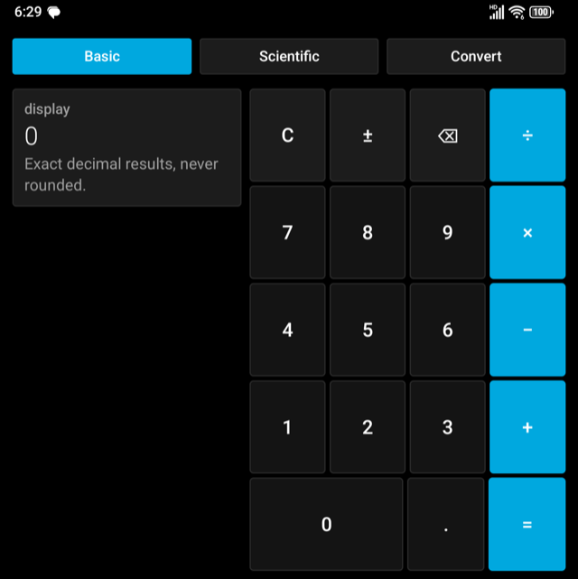 | 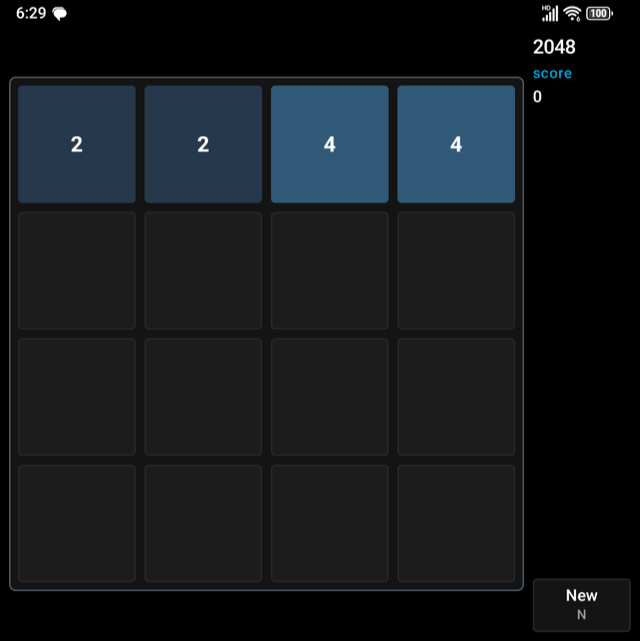 | 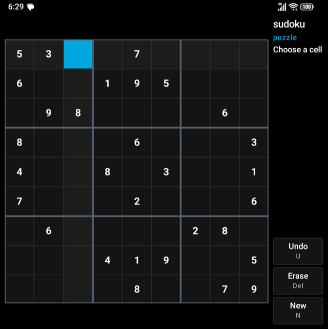 |
| <sub>Notes</sub> | <sub>Calc Plus</sub> | <sub>2048</sub> | <sub>Sudoku</sub> |

## Default apps and weather

Tiles and icons open whatever app your phone uses for calls, messages, mail, camera, calendar, browser, gallery and music. Tenseven has **no weather tile of its own**, because it never connects to the internet. For live weather, add a weather app's widget on the Widgets page.

## Backup

Launcher Settings, then **Backup**, saves or restores your settings as a file through Android's file picker. Letter assignments and speed dial are not included, because they hold contact names.

|  |
|---|
|  |
| <sub>Backup and restore</sub> |

## Privacy

No network access, no analytics, no accounts. Optional permissions: notification access (Hub, Now Playing), usage access (recent apps), calendar (agenda), contacts (names), Do Not Disturb and system settings (sound). The accessibility service for double-tap to lock is optional and reads nothing.

## Screenshots

The pictures in this guide are in [`images/`](images/). `tools/take-screenshots.sh` captures the setup steps, Launcher Settings and the home screens from a phone connected over adb. See [`SCREENSHOTS.md`](SCREENSHOTS.md).

## Troubleshooting

- **A permission is greyed out**: use Allow restricted settings (above).
- **Silent mode will not stick**: grant Do Not Disturb access.
- **The lock layer does not appear on wake**: use **Preview the lock layer** (Launcher Settings or Setup) to check the screen itself, confirm both permissions show as allowed, and note that Android may block a screen from starting in the background. Switch it off if it does not work on your phone.
- **Wallpaper not visible on the BlackBerry 10 home**: Launcher Settings, Wallpapers, **Show wallpaper behind the BlackBerry 10 home**.
- **A small "<" appears instead of the peek**: that is Android's Back gesture. Go to the Home page, start the drag at the left edge halfway down the screen, or select the Hub slot of the bottom bar and press Space.
- **Wrong home after an update**: press Home and choose Tenseven, then **Always**.
- Report problems with the device, Android version and steps on the GitHub issue tracker.

## Theme files

A theme file is a small text file (JSON, under 64 KB) named like `ocean.tenseventheme.json`. It is only read as data: it
can set colours and a wallpaper, and nothing in it is ever run. Only `format`, `version`, `name`, `mode` and `accent`
are required; the rest take the defaults of the mode.

```json
{
  "format": "tenseven-theme",
  "version": 1,
  "name": "Ocean",
  "mode": "dark",
  "accent": "#00A8DF",
  "onAccent": "#FFFFFF",
  "palette": { "background": "#001018", "card": "#0B1A22", "tile": "#122632", "line": "#1E3A48",
               "text": "#FFFFFF", "muted": "#9EB4C0", "dim": "#5B7280" },
  "wallpaper": { "top": "#1F6FEB", "bottom": "#9CD3FF", "glow": "#FFF4C2", "ridge": "#0B3C8C", "seed": 11 }
}
```

- `mode` is `dark`, `light` or `follow-system`. Colours are `#RRGGBB`. `seed` (0 to 9999) shapes the wallpaper ridges.
- Tenseven refuses a file whose text, muted or accent colour would be hard to see: text needs a contrast of 4.5 on the
  background, muted and accent 3, and `onAccent` 2.5 on the accent.
- Up to 12 imported themes are kept. They are saved with a backup. The peek always uses the phone's colours.
