# TenSeven Launcher user guide

> **Future 2.0 change:** Optional Phone, Calendar, Tasks/Remind, Notes, Calculator, Sound Profiles and Games Pack are planned as separately installed APKs with an installation wizard inside Launcher Setup and Settings. **They are still bundled in the current development APK**. This guide's existing install steps describe the current shipped experience, not a working multi-APK wizard. See [ADR-0001](decisions/ADR-0001-MODULAR-COMPANION-APKS.md) and [release/install specification](2.0/COMPANION_DISTRIBUTION.md).

This branch documents the upcoming 2.0 changes. The installation download and screenshots
below still refer to released version 1.0.0; they do not show the new navigation or action panels.

Requires Android 14 or newer. Both home layouts work with touch; keyboard-equipped phones
also offer letter shortcuts and focus navigation. Screenshots below are owner-supplied
1.0.0 captures from a Unihertz Titan 2, taken on November 3, 2026. Tap an image to view it
at full size. See [capture notes](images/v1.0.0/README.md) for coverage and limitations.

## Install and first setup

Download `TenSeven-Launcher-1.0.0.apk` from the
[GitHub release](https://github.com/aimindseye/tenseven-launcher/releases/tag/v1.0.0) on your phone,
open it and follow Android's installation and Play Protect scanning prompts. ADB and a computer
are not required. Then choose TenSeven as Android's default Home app. The debug build is a
separate app. Lite is retired. Setup explains each optional permission and shares
its settings controls with Launcher Settings. Permissions can be skipped and enabled later.
Active Frames setup applies only to the BlackBerry 10 home style and follows notification access.

| Permission or choice | What it enables |
|---|---|
| Notification access for TenSeven | Hub notifications, notification counts/excerpts and available media sessions |
| Hub source filters (optional) | Automatically include Android-delivered notifications, or use a manual selection |
| Calendar permission and selected calendars in Hub settings | Upcoming events and Calendar summaries |
| Usage access | Observing apps opened outside TenSeven; not access to their screens |
| Contacts | People search and contact actions |
| Display over other apps plus notification access | Optional lock layer over Android's own lock |
| Android capture consent | A separate user-approved screen-sharing preview |

Notification access is not required for basic app launching or ordinary Active Frames cards.
If sideloading blocks a permission, Android Settings → Apps → TenSeven Launcher → three-dot
menu → Allow restricted settings may be needed before granting access. Device menus vary.


| Home style chooser | Launcher Settings with BB7 selected |
|---|---|
| <a href="images/v1.0.0/home-style.png">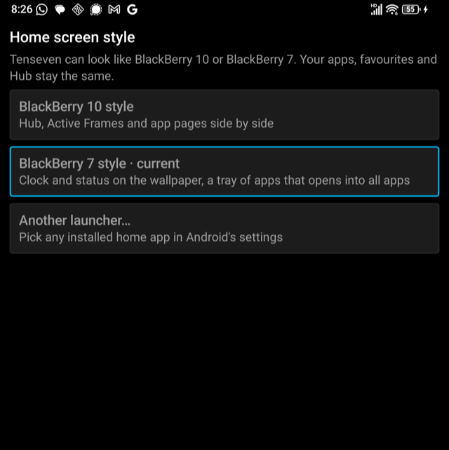</a> | <a href="images/v1.0.0/launcher-settings-01.png">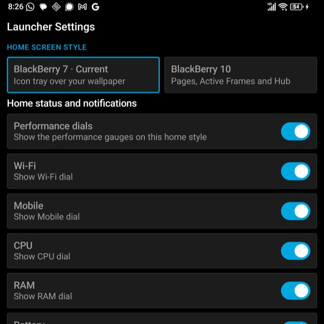</a> |

## Home layouts and notification icons

Choose BlackBerry 7 or BlackBerry 10 in Launcher Settings. BB7 provides a banner, home icons
and app panels; BB10 provides Hub, Active Frames and app pages. Phone, Search and Camera
are available from the BB10 bottom bar. The optional Widgets page sits to the left of Hub.

Grid columns/rows, icon size and text adapt to the available window and saved choices.
Home notification display can be compact or show all enabled notification-app icons, independently
for each home style. In compact mode, `+N` opens Hub. Tapping an individual app icon opens
that app's notifications in Hub. This does not add per-app buttons to Hub's navigation strip.

Choose status dials in Launcher Settings; storage is an option alongside network, CPU, RAM,
battery and signal. The speaker opens enabled Sound Profiles or cycles Android sound modes;
Do Not Disturb permission may be needed for Silent.


| BlackBerry 10 Home | BlackBerry 7 Home | BB10 app grid |
|---|---|---|
| <a href="images/v1.0.0/home-bb10.png">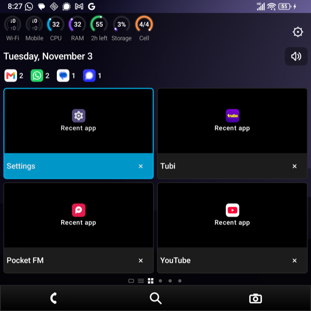</a> | <a href="images/v1.0.0/home-bb7.png">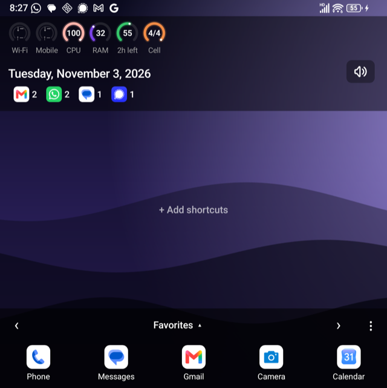</a> | <a href="images/v1.0.0/home-bb10-swipe-left.png">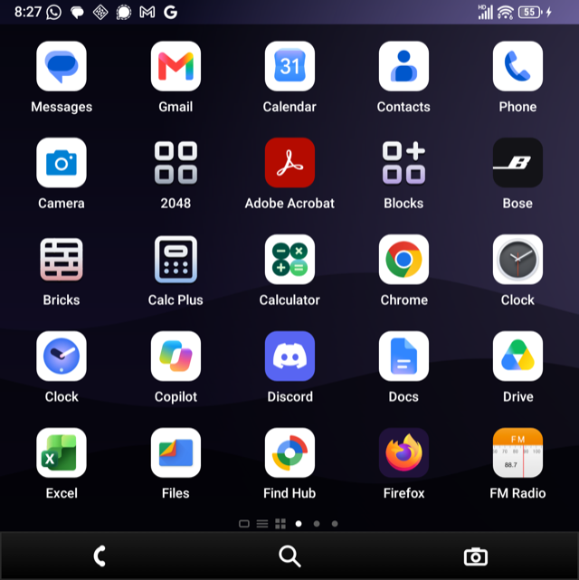</a> |


| BB7 home shortcut | BB7 All panel | BB7 menu |
|---|---|---|
| <a href="images/v1.0.0/bb7-desktop-icons.png">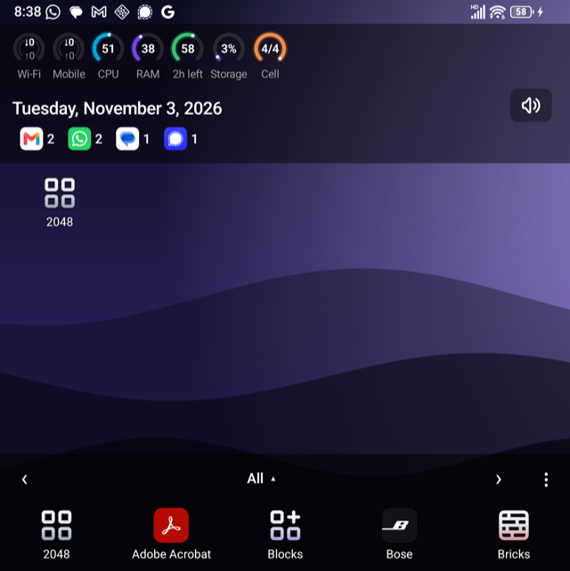</a> | <a href="images/v1.0.0/bb7-tray-all.png">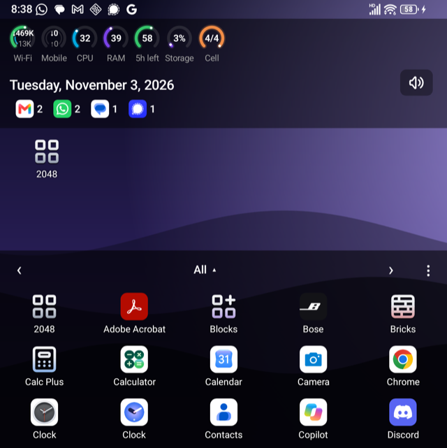</a> | <a href="images/v1.0.0/bb7-menu.png">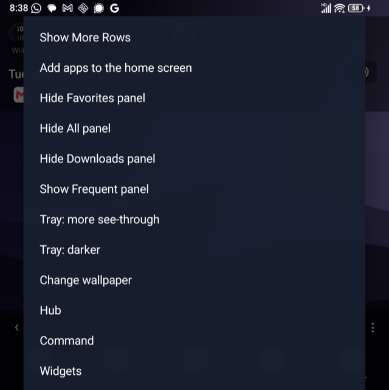</a> |


| Notification display choice and storage option | Performance dials with storage enabled |
|---|---|
| <a href="images/v1.0.0/launcher-settings-02.png">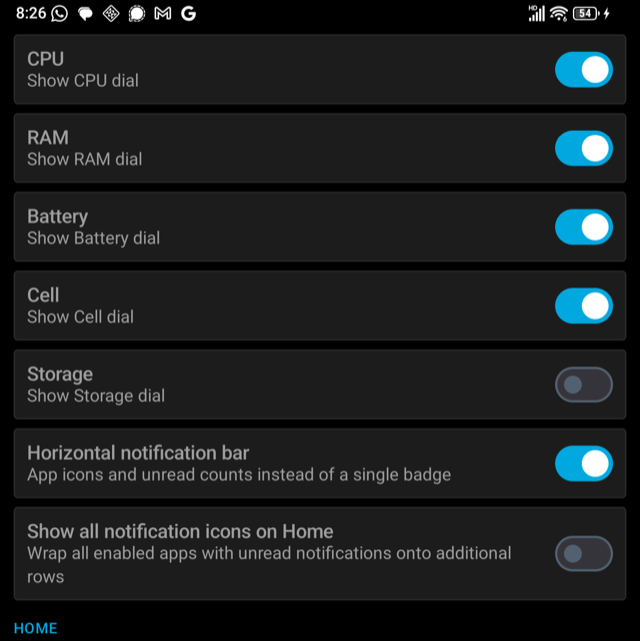</a> | <a href="images/v1.0.0/notification-display-settings.png">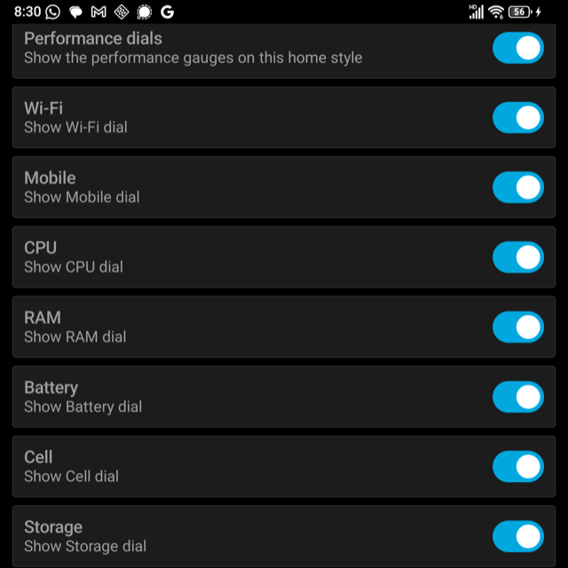</a> |

| BB7 icon size and grid choices |
|---|
| <a href="images/v1.0.0/launcher-settings-03.png">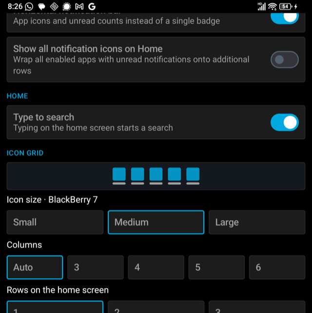</a> |

The notification setting is shown with show-all disabled; the storage dial is shown enabled in the second capture.

## Hub and peek

Hub navigation has ten actions: Hub, Messages, Email, Unread, Search, Calls, Calendar,
Snoozed, Remind and Contacts. They occupy one horizontal row. Swipe sideways on narrower
windows to reach the remaining actions; touch targets stay usable. Notification totals may
increase a button's width. No separate row of individual notification-app icons is shown.

After granting Android notification access, Hub automatically displays notifications delivered
to TenSeven. No separate app assignment is required. Hub settings offers optional app filters
and a manual-selection mode. Android can restrict notifications or redact their content; an
app with notifications disabled or no active notification contributes no entry.

Select a row to open its action panel. Available actions come from the source notification: reply,
reply all, forward or other provider actions appear only when supported. Text actions require
Send; selecting a row alone does not read or launch it. Hub also offers local mark-read, snooze
and reminder controls. Ordinary notifications appear in All, not Messages or Email. Snoozed items
and reminders have their own shortcuts. Calendar permission and calendar selection are in
Hub settings, independently of notification access. Drag inward from the left edge of BB10
Home to open the rounded peek panel. Notification text is hidden while the device is locked.


| Hub with all ten navigation actions on one row | Rounded Hub peek |
|---|---|
| <a href="images/v1.0.0/hub-page.png">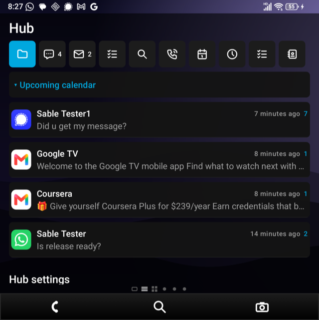</a> | <a href="images/v1.0.0/hub-peek.png">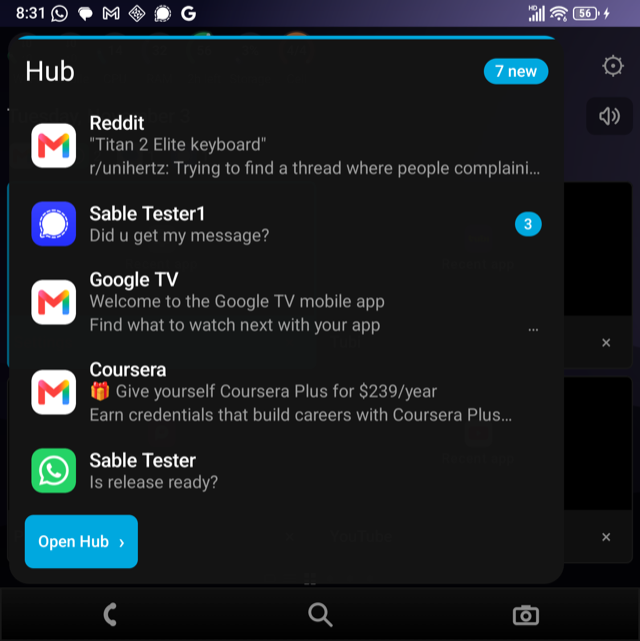</a> |


| Snoozed conversation | Remind view |
|---|---|
| <a href="images/v1.0.0/hub-snoozed.png">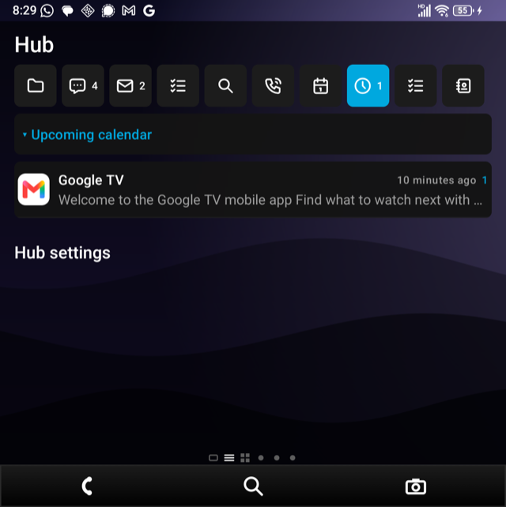</a> | <a href="images/v1.0.0/hub-remind.png">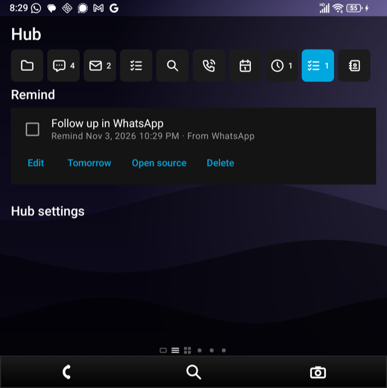</a> |

## Active Frames

Active Frames belong to BB10 Home. They show the last eight apps opened, including ordinary
cards without summaries. Opening a ninth replaces the oldest card. Closing a card removes
it from TenSeven; it does not force-stop the app. An empty frame window stays empty: old
usage history, calendar events and incoming notifications do not create extra app cards.

| Card information | Setup and limitations |
|---|---|
| Recent app | No summary setup needed; opens the corresponding app/profile |
| Media, podcasts, audiobooks | Enable notification access. The player must publish a media session or supported metadata |
| FM Radio and other players | Opt in to notification-text fallback in App integrations when the player lacks session metadata; station details appear only if the app publishes them |
| Calendar | Grant Calendar access and choose calendars in Hub settings; enable live tiles |
| Mail and messaging | Enable notification access and opt in to notification excerpts in App integrations; optional Hub source filters apply |
| TenSeven Notes, Tasks/Remind, Calc Plus | Enable the corresponding extras/integration; summaries reflect TenSeven-owned data |
| Word, Excel, PowerPoint | Ordinary recent-app cards. File linking was removed; no private document or automatic latest-file preview |
| Shared screen | Explicit Android capture consent; separate preview, not a per-app automatic snapshot |

Live tiles enrich matching cards. They do not replace Android's app lifecycle: Back can exit
an app's activity, Home can leave it in the background, and each media app chooses whether
to continue playback and expose its session. A card labelled Recent app is expected when
no summary data is available. The launcher cannot keep another app playing or force it open.
Protected/DRM windows may be excluded from screen capture.


| Media summaries inside existing app frames | No app frames, with usage-access guidance |
|---|---|
| <a href="images/v1.0.0/active-frames.png">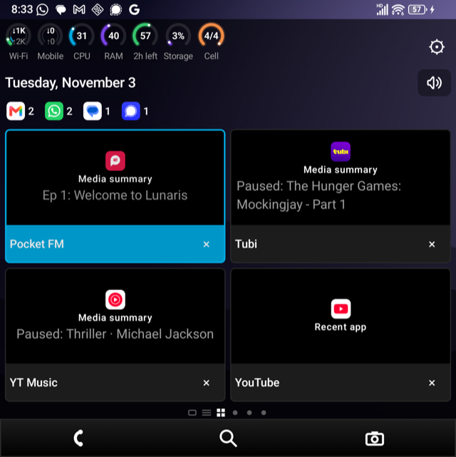</a> | <a href="images/v1.0.0/home-empty.png">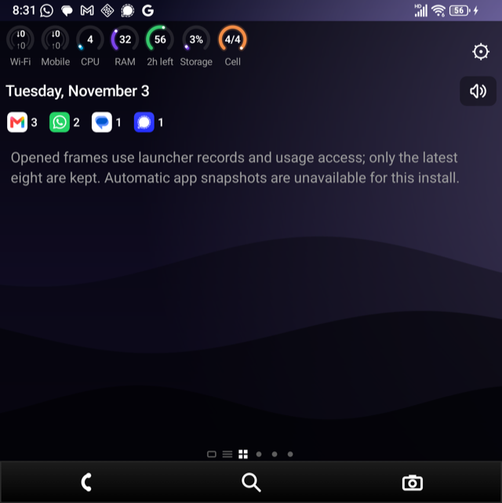</a> |


| Active Frames App integrations |
|---|
| <a href="images/v1.0.0/frame-integrations.png">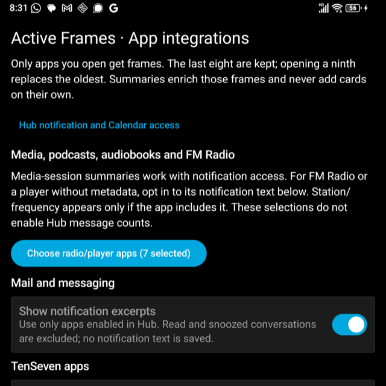</a> |

The integrations capture shows player sources and notification excerpts; the TenSeven-app controls continue below the visible area.

## Widgets and editing

Enable the Widgets page and optional built-in Calendar, Alarm, Battery and Now playing cards
in Launcher Settings. Add an installed app's widget through the picker and finish Android's
bind/configuration prompts. Edit widgets to move Up/Down, make Shorter/Taller or Remove.
Configuration cancellation should not leave a phantom widget. Widget IDs belong to this
installation and are not portable backup data. Edit Home has Reset, Cancel and Done controls.


| Built-in glance cards | Added clock widget | Shorter, Taller, Up, Down and Remove controls |
|---|---|---|
| <a href="images/v1.0.0/widgets-page.png">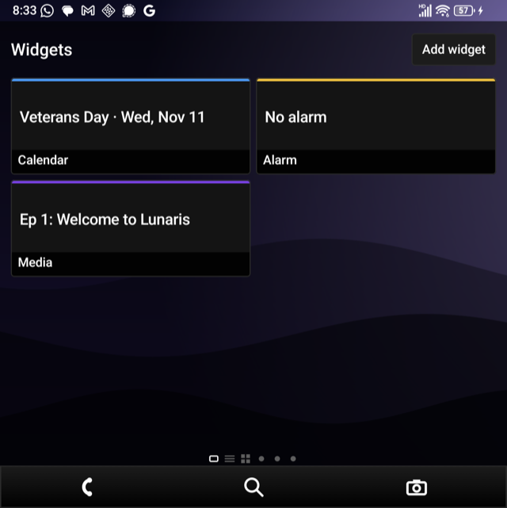</a> | <a href="images/v1.0.0/widgets-page-with-widget.png">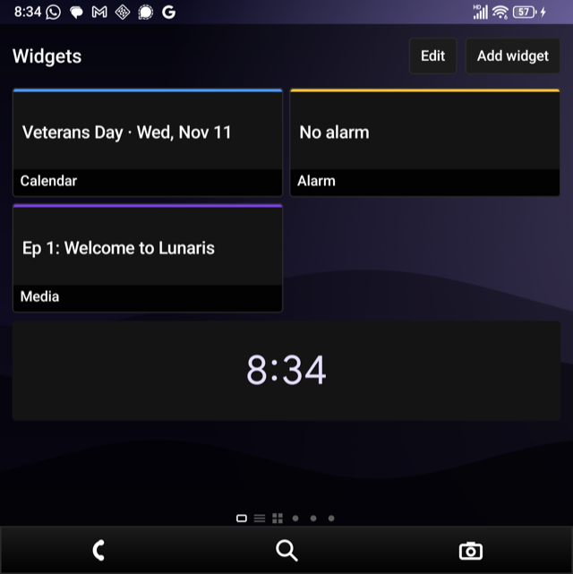</a> | <a href="images/v1.0.0/widgets-page-edit.png">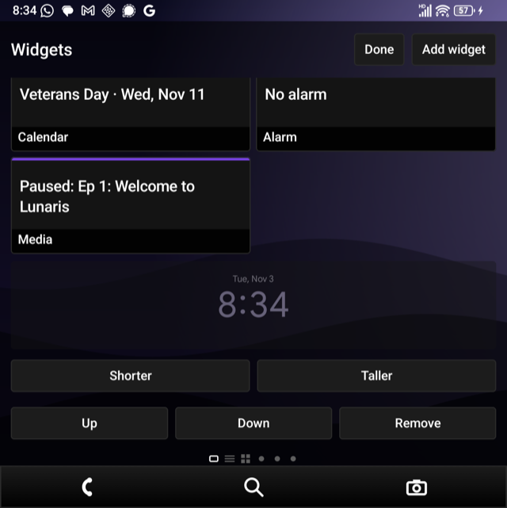</a> |


| Edit Home with Reset, Cancel and Done |
|---|
| <a href="images/v1.0.0/edit-home.png">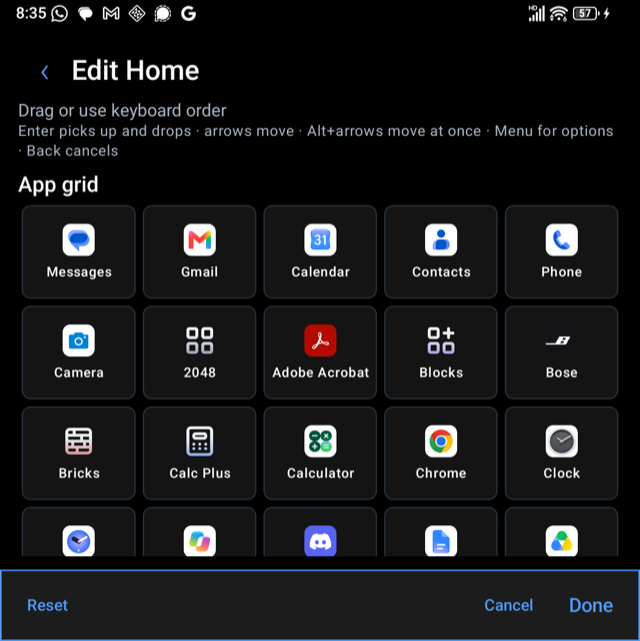</a> |

## Keyboard and device profiles

Alt+Space opens Command. Type on Home to search when enabled; hold assigned letters to
launch an app. Alt+Enter opens the BB7 menu. Navigate focus with arrows/trackpad and use
Enter to select; device-specific key availability varies. Launcher Settings → Device
compatibility shows the detected profile and a foreground key probe. Profiles influence
keyboard/window policies; responsive layout also uses actual width, density and font scale.
A profile name is not proof the hardware has passed qualification. KEY2 is not in active P3 scope.


| Titan 2 profile and foreground keyboard diagnostics |
|---|
| <a href="images/v1.0.0/device-compatibility.png">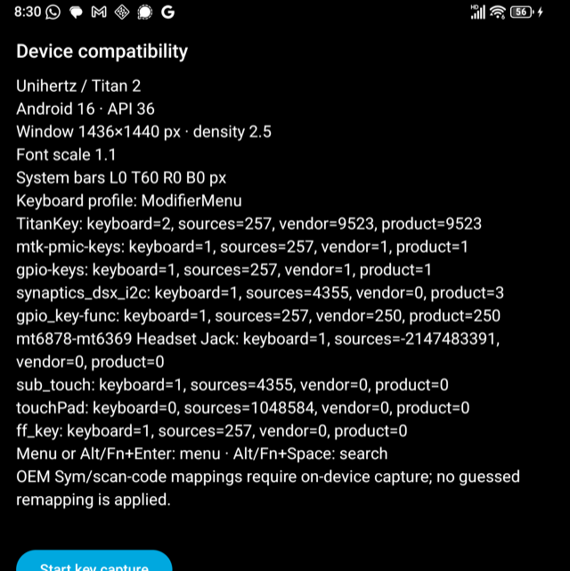</a> |

## Command and app privacy

All Apps lists applications and their available permission/profile information. Space opens
an app's privacy details. Command searches apps, people, settings and actions; `assign` and
`unassign` manage letter shortcuts. Private Space/work apps remain subject to Android access.


| Command search | All Apps | Selected app privacy and actions |
|---|---|---|
| <a href="images/v1.0.0/command.png">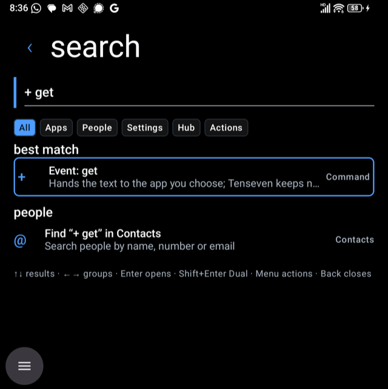</a> | <a href="images/v1.0.0/all-apps.png">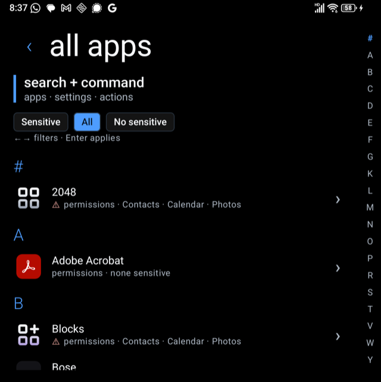</a> | <a href="images/v1.0.0/app-privacy-row.png">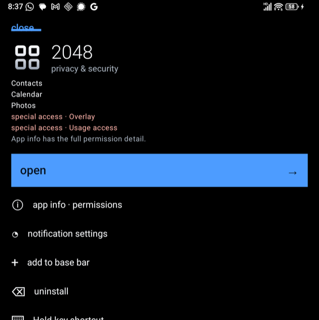</a> |

### Command prefixes

Type the prefix first, with nothing before it, then your text. Each one shows as a row in Command; press Enter on the row to run it. The first three are the quick
actions that came from the MinkLauncher Magic Box; the rest narrow the search and are Tenseven's own.

| Type | What it does | Example |
|---|---|---|
| `-text` | Shows a to-do row; Enter opens Android's "send to" list so you pick the app that keeps it. Tenseven keeps nothing | `-Buy milk` |
| `/text` | Shows a note row; Enter sends the text to the app you pick the same way | `/Draft the release notes` |
| `+text` | Shows an event row; Enter opens your calendar's new-event screen with that title | `+Dinner Friday at 7` |
| A web address | Shows an open-address row; Enter opens it in the browser (`https://` is added when missing) | `example.com/page`, `www.example.org` |
| `?name` | Searches apps only | `?cam` |
| `@name` or `#name` | Searches people only | `@alex` |
| `!action` | Searches actions only | `!` then the first letters of an action |
| `/settings text` | Searches Settings only | `/settings wifi` |
| `/apps text` | Apps only, the same as `?` | `/apps clock` |
| `/hub text` | Searches the Hub only | `/hub invoice` |
| `/private`, `/dual`, `/work` | Lists the apps of one profile: Private Space, Dual (cloned) apps, or the work profile | `/work mail` |
| A phone number | Shows a call row; Enter opens the dialer with the number (it does not dial for you). Its menu also offers a message and Add to contacts. Needs three digits or more | `917 555 0100` |

- A `/` that starts one of the scope words (`settings`, `apps`, `hub`, `private`, `dual`, `work`) is that scope, not a
  note. To write a note that starts with one of those words, put something else first.
- A prefix with nothing after it does nothing yet; keep typing.
- A number that starts with `+` is read as an event, so type it without the plus (or use `#` first).
- Without a prefix, Command searches everything: apps, people, Settings and actions, with the apps you open most first.
- Not included from Mink: the `*` prefix for AI. Tenseven has no network access.

## Themes, extras, lock and backup

Launcher Settings provides themes, theme-file import/export, wallpapers, icon/grid choices,
extras and backup/restore. Notes, Tasks/Remind and Calc Plus keep their own local data; these
are distinct from Command's send-to-another-app note/to-do actions described above.
Optional games and Sound Profiles follow the launcher theme.

The lock layer is a visual cover, not a replacement for Android authentication. Preview it
before enabling it. Back up settings through Launcher Settings; restore does not transfer
Android permission grants, widget IDs or a live screen-capture consent session.


| Theme and wallpaper choices | Appearance and icon-pack choices |
|---|---|
| <a href="images/v1.0.0/launcher-settings-05.png">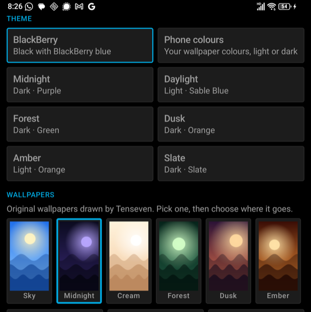</a> | <a href="images/v1.0.0/appearance.png">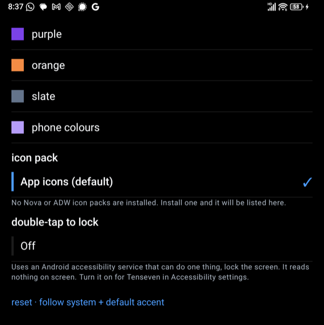</a> |


| Notes | Tasks and Remind | Calc Plus |
|---|---|---|
| <a href="images/v1.0.0/notes.png">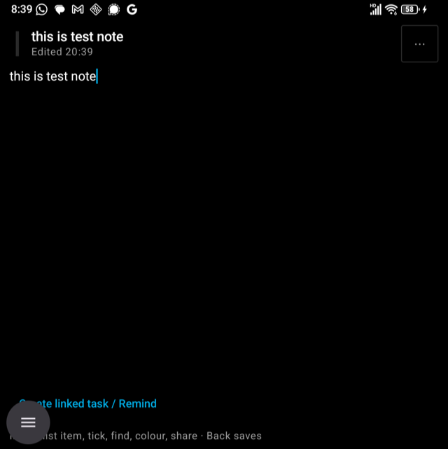</a> | <a href="images/v1.0.0/tasks.png">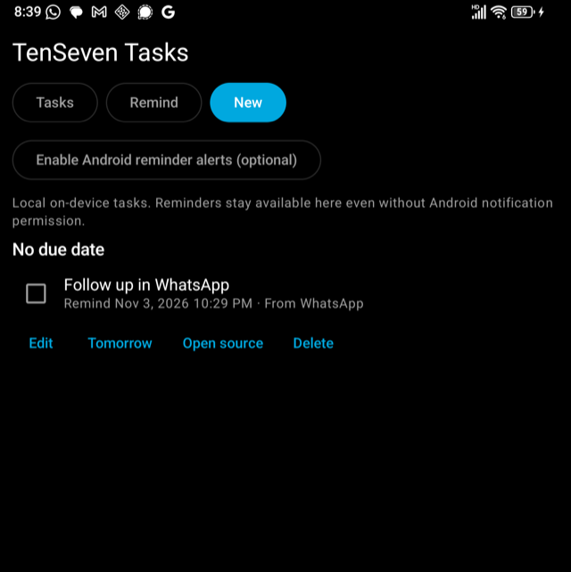</a> | <a href="images/v1.0.0/calc-plus.png">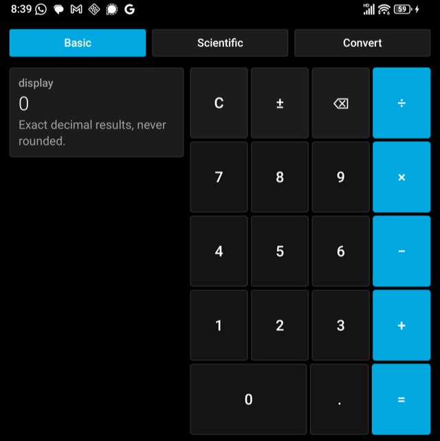</a> |


| Sound Profiles | 2048 | Sudoku |
|---|---|---|
| <a href="images/v1.0.0/sound-profiles.png">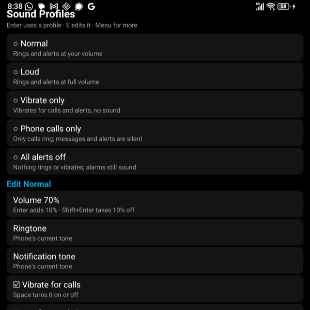</a> | <a href="images/v1.0.0/game-2048.png">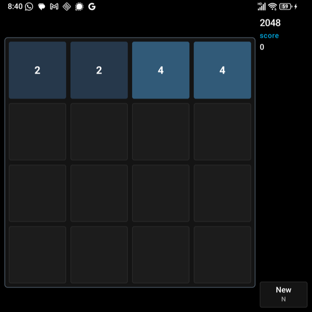</a> | <a href="images/v1.0.0/game-sudoku.png">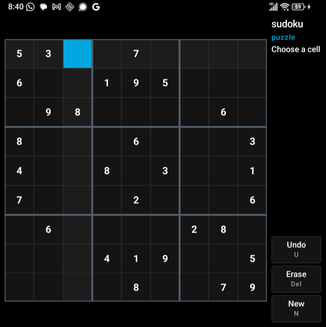</a> |


| Lock-layer controls and Device compatibility entry | Lock layer after waking the phone |
|---|---|
| <a href="images/v1.0.0/launcher-settings-bb7-10.png">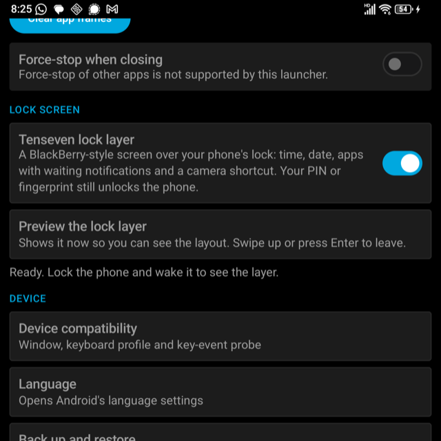</a> | <a href="images/v1.0.0/lock-layer-on-wake.png">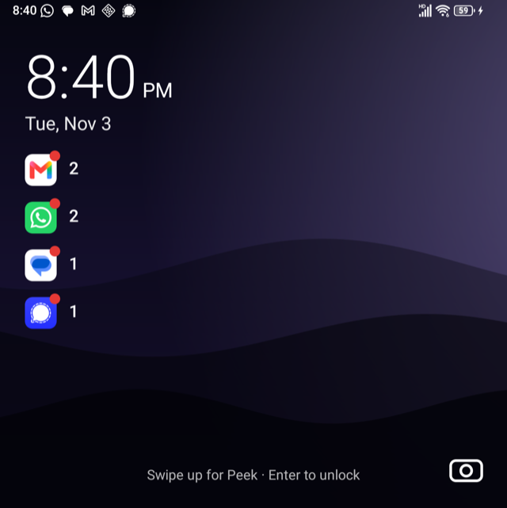</a> |

## Troubleshooting

- Missing summaries: check notification access, optional Hub source filters, Calendar selection and live-tile settings as applicable.
- A player shows Recent app: check whether it still exposes playback/session metadata after leaving it.
- No Office document text: expected; the launcher cannot inspect Word/Excel/PowerPoint private content.
- Missing Hub shortcut: scroll its single navigation row sideways.
- APK update rejected: verify the package, version code and registered signing identity; do not regenerate the release key.

## Theme files

A theme file is a small text file (JSON, under 64 KB) named like `ocean.tenseventheme.json`. It is only read as data: it
can set colours and a wallpaper, and nothing in it is ever run. Only `format`, `version`, `name`, `mode` and `accent`
are required; the rest take the defaults of the mode.

```json
{
  "format": "tenseven-theme",
  "version": 1,
  "name": "Ocean",
  "mode": "dark",
  "accent": "#00A8DF",
  "onAccent": "#FFFFFF",
  "palette": { "background": "#001018", "card": "#0B1A22", "tile": "#122632", "line": "#1E3A48",
               "text": "#FFFFFF", "muted": "#9EB4C0", "dim": "#5B7280" },
  "wallpaper": { "top": "#1F6FEB", "bottom": "#9CD3FF", "glow": "#FFF4C2", "ridge": "#0B3C8C", "seed": 11 }
}
```

- `mode` is `dark`, `light` or `follow-system`. Colours are `#RRGGBB`. `seed` (0 to 9999) shapes the wallpaper ridges.
- Tenseven refuses a file whose text, muted or accent colour would be hard to see: text needs a contrast of 4.5 on the
  background, muted and accent 3, and `onAccent` 2.5 on the accent.
- Up to 12 imported themes are kept. They are saved with a backup. Check the preview before applying a theme.
