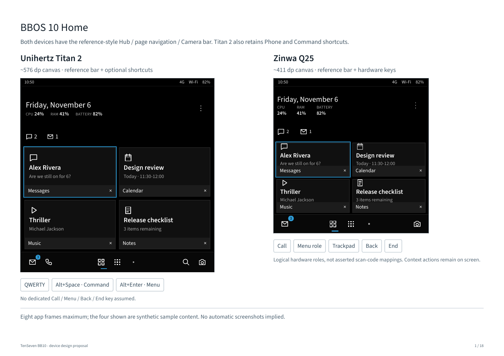
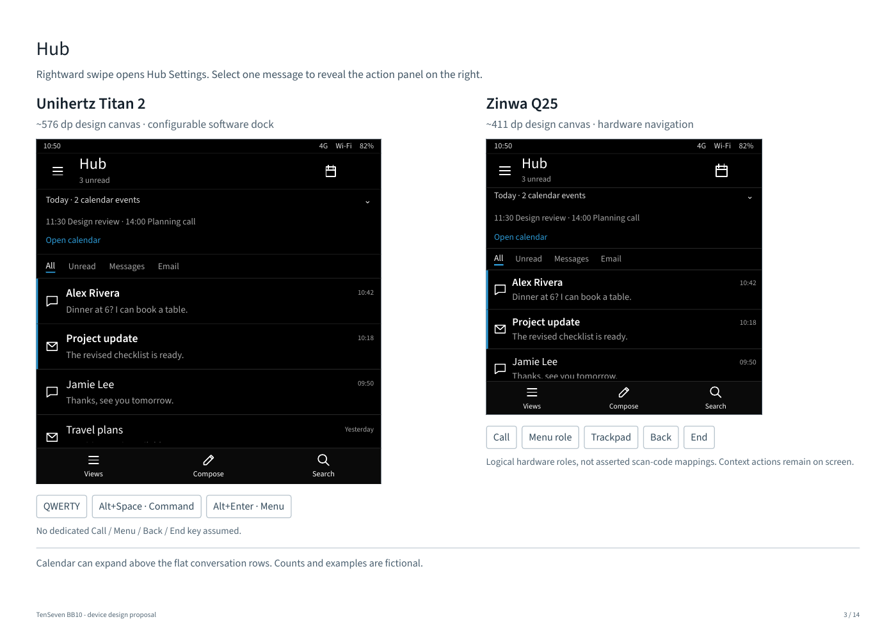
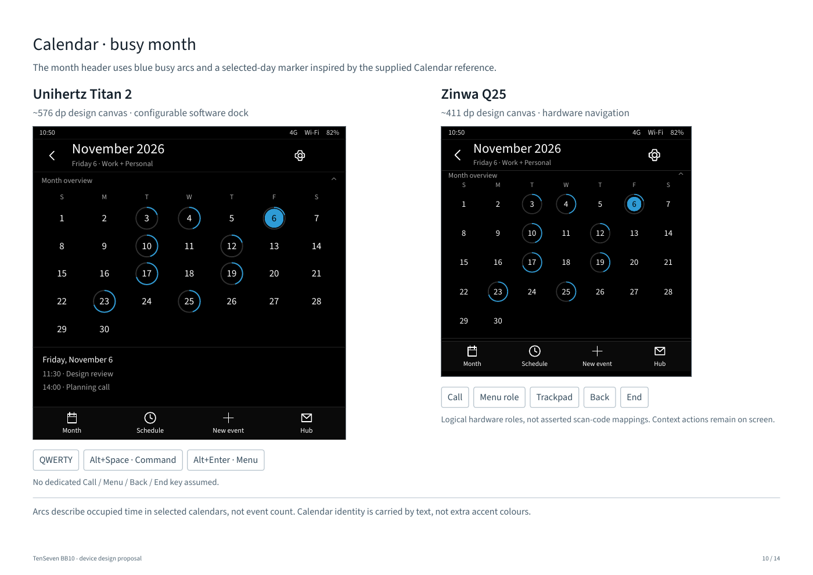
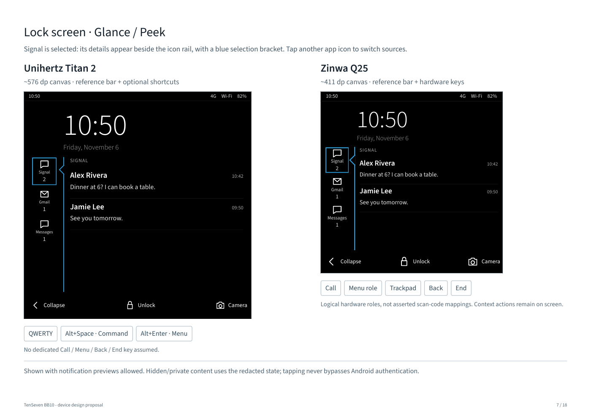
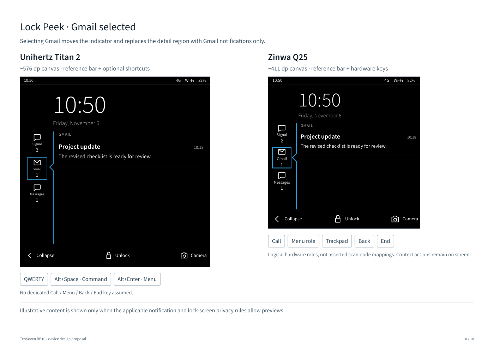

# TenSeven BlackBerry 10 device design review

The owner approved the design direction, with the lock-screen and lower-bar revisions below.
No production app code or permission declarations are changed.
The released 1.0.0 APK remains unchanged.

Open `index.html` with its `fonts/` directory beside it, or read
[the paired-screen review](output/pdf/TenSeven-BB10-Titan2-Q25-Design-Review.pdf).
The local preview is an offline, JavaScript-free click-through. Screen tabs and in-screen
links work with mouse, touch or keyboard. Captions specify proposed gestures; this file does
not implement Android gesture recognition, authentication, phone calls or notification actions.

## Scope and screen inventory

Every screen has separate Titan 2 and Zinwa Q25 layouts: 36 designs, 18 paired pages.

1. BBOS 10 Home
2. BBOS 7 Home
3. Hub, with expandable upcoming-calendar summary
4. Hub Settings revealed by a rightward swipe on Hub
5. Single selected message with an action panel on the right
6. Lock screen
7. Lock-screen Peek with Signal selected
8. Lock-screen Peek with Gmail selected
9. Lock-screen Peek with Messages selected
10. Lock-screen Peek with content hidden by privacy rules
11. Phone recent calls
12. Phone keypad
13. Calendar month with busy indicators
14. Calendar day/week schedule
15. Command navigation sample
16. Home menu with touch-accessible Phone / Command / Camera
17. App-grid destination for the lower navigation bar
18. Camera handoff sample

All names, messages, events and values are fictional design fixtures. These are proposed
interfaces, not screenshots or proof of features implemented on Android.

## Approved visual direction

- Black canvas #000000; limited raised areas #141414; dividers #262626.
- White primary text; secondary #A6A6A6. Blue #2E9BD6 for focus, selection markers and actions.
- Red #E0463C only for meaningful urgent/error states, such as missed calls.
- Source Sans 3, bundled locally for the review. Implementation needs Android font resources,
  script fallback and system font-scale handling; not a ROM-only font-family lookup.
- Flat lists and thin separators. No routine filled blue selection tiles.
- Keyboard focus uses a blue outline. Unread state uses weight and a small blue edge;
  focus and unread are separate states and do not depend on colour alone.
- Hub Peek retains its rounded outer panel. The lock-screen Peek uses the latest reference:
  a vertical app rail and inline details with a selection bracket, not a floating card.
- Keep installed-app icons and user icon packs. Schematic control glyphs in this review are
  original simple geometry; production should use TenSeven's existing licensed glyph set.
- Existing non-BlackBerry themes and user configuration remain available.

## Device policy: capabilities and measured window, not a name-only switch

| Policy | Titan 2 | Zinwa Q25 |
|---|---|---|
| Design grid | Rounded 576 dp square | Rounded 411 dp square |
| Evidence | Owner capture: window 1436x1440 px, density 2.5, font scale 1.1 | Prior Q25 reference: 720x720 px, density 280 |
| Home lower bar | Hub / page navigation / Camera, plus Phone and Command shortcuts | Hub / page navigation / Camera |
| Shortcut preference | Phone / Command shortcuts remain configurable | Optional shortcuts remain configurable; hardware keys do not remove the reference navigation bar |
| Global navigation roles | Do not assume dedicated Call/Menu/Back/End keys | Call/Menu/Back/End/trackpad roles provided by hardware, subject to verified event mapping |
| Context actions | Visible screen-specific action bar | Same screen-specific actions remain available |
| Menu access in TenSeven | Alt/Fn+Enter where verified; visible menu control | Verified Menu action and visible menu control |
| Command in TenSeven | Alt+Space where verified; Home dock | Configured shortcut and menu entry |

The canvases illustrate usable-density differences, not measured physical device outlines.
Actual layout must use current WindowMetrics, insets, density, font scale and input devices.
The Q25 reference is not physical qualification of TenSeven. Key labels do not assert scan codes.

The supplied SableOS handover records a BlackBerry-labelled key reporting HOME and assigns
long-press Menu through a ROM overlay. An ordinary launcher cannot assume this overlay or
intercept HOME globally. Use measured InputDevice/KeyEvent evidence before enabling a binding;
keep OS-reserved Home, Recents, call and End behavior authoritative. Device overrides are
configurable, and unknown keyboards get a safe touch-capable fallback.

## Hub interaction contract

- Rightward horizontal swipe on Hub reveals Hub Settings from the left, leaving Hub visible.
  A leftward return swipe or Back closes it. A visible Views button offers equivalent access.
- Distinguish horizontal panel intent from vertical list scrolling and nested calendar gestures.
  A full-screen threshold and edge policy need validation with Android back gestures.
- Selecting a single message reveals the right action panel. Moving focus or opening the panel
  does not mark it read, reply, snooze or change the source notification.
- Open app, Reply when RemoteInput is supported, Mark read, Snooze and Remind remain explicit.
  No action claims to delete an underlying email or force-stop another app.
- Back closes the action panel before leaving Hub; restore focus to the selected row.
  Announce selection and panel entry to accessibility services.
- No bulk notification clearing is introduced. Existing Hub sources, snoozed state, reminders,
  calendar choices and notification counts remain the same data sources.
- On Q25 the settings/action panels scroll independently where needed. This is expected;
  menu items must never become unreachable just to keep every item above the fold.

## Calendar and supplied busy-indicator reference

The supplied image is a layout reference, not a request to copy its green theme or artwork.
Adopt the collapsible month, seven-day strip and schedule hierarchy using TenSeven's palette.

- Busy arcs represent occupied intervals within the chosen visible day range, from selected
  Android CalendarProvider calendars. Merge overlaps before calculating occupied duration.
- Event count and occupied time are different values. All-day events get a separate band;
  do not turn an all-day birthday into an apparently fully booked workday by default.
- Blue conveys occupancy and selection; labels/icons identify calendar sources without needing
  multiple decorative colours. Non-colour text descriptions must convey the busy information.
- The Q25 full-month view omits the agenda below it so seven columns can retain roughly
  48 dp date targets. Select a day to open its schedule. Titan 2 can show the short agenda.
- The compact Q25 schedule shows fewer hours and scrolls. It must not compress a full day into
  illegible appointment blocks. The overview can collapse to the week strip.
- Selecting a day updates the agenda; Today returns to the current day. Test locale week start,
  month boundaries, timezone/DST, overlapping events, recurring events and empty/denied states.
- Hub's upcoming-events disclosure remains independent of the full Calendar view.

## Phone and Calendar are a separate implementation boundary

TenSeven 1.0.0 currently resolves installed/default Phone and Calendar apps through DefaultApps.
It cannot recolour Google Phone, Google Calendar or other third-party applications.
These designs therefore describe optional TenSeven-owned Phone and Calendar screens,
with reusable SableOS presentation adapted to ordinary Android APIs.

- Calendar: read only explicitly permitted/selected CalendarProvider sources; initial event
  creation/editing can hand off through supported Android intents. No independent sync engine.
- Phone: contacts/number entry can hand off to the installed dialer. Real call history and
  default/in-call replacement need a separately validated public dialer-role/InCallService lane.
  Do not import SableOS signature permissions or promise emergency-call replacement.
- The preview's Call, Compose and New-event labels are visual proposals, not real operations.
  Their eventual routes and capability-disabled states must be wired to supported behavior.

## Owner revision: reference-style lower navigation bar

The new Active Frames and BBOS 7 Home references supersede the earlier Q25-hidden-dock default.
Use one shared lower bar on both devices and both Home styles, not two stacked docks:

- Hub icon and unread indicator on the left.
- Context/page controls and page-position dots in the centre: Frames/Favorites, app grid, app pages.
- Camera on the right.
- Titan 2 retains Phone and Command shortcut controls within the same row; they are configurable.
- Q25 uses the compact reference row. Phone and Command remain available through hardware roles,
  configured shortcuts and the touch-accessible Home menu.
- Keep a stable position across Active Frames, BB7 Home and app pages. Preserve touch targets and
  the space available to frames; do not create sample frames or extra app records for navigation.

## Lock screen and per-app Peek

The owner approved the reference interaction: a vertical rail of notification-app icons and
counts beside the clock/content area. Selecting an icon shows only that app's notifications
in the detail region to its right, with a thin selection bracket aligned to the chosen icon.
Selecting a different icon replaces the details; selecting/collapsing must not mark read,
dismiss, reply or open the original app. Trackpad/arrows move between icons; Enter selects.
Use actual installed app icons in production; schematic glyphs and labels identify the review fixtures.

The review includes Signal, Gmail and Messages selections, plus an explicit content-hidden
state. The preview text is fictional; neither reference image nor its message contents is copied.

Notification selection is separate from permission to reveal content. Show preview details
only when the applicable Android notification visibility, lock-screen privacy and user settings
allow them. Otherwise keep the icon/count and render a content-hidden explanation in the same
region. Clicking must never bypass privacy restrictions. Opening, replying, or revealing protected
content requires the appropriate Android authentication. Respect policy changes while the panel
is open and clear any revealed content immediately when it becomes disallowed.

The TenSeven lock layer remains a cover over Android keyguard. It does not replace PIN or
fingerprint rules, and it cannot install a Picture Password credential. The camera uses the secure
handoff where Android supports it. The Home navigation bar is not drawn on lock-screen surfaces.

## Implementation sequence and acceptance

1. Design approval is recorded. Apply the owner-requested lock Peek and shared lower-bar
   revisions before beginning the already-planned implementation phases.
2. Add shared theme/type/row/action primitives behind the BlackBerry theme. Preserve saved
   preferences; add contrast, keyboard focus and configuration/migration tests.
3. Restyle Hub/Settings/Peek; add panel gesture arbitration, close/focus restoration and
   accessibility coverage before changing Home navigation.
4. Apply Home/frame/BB7/Command/lock styling. Retain last-eight-opened-app policy, real summaries,
   privacy boundaries and explicit capture consent; never add sample or history-only frames.
5. Deliver Calendar-owned surfaces and Phone public-API handoff first. Treat full dialer-role
   replacement as its own feature, not a side effect of a theme update.
6. Run API 34/35 responsive/lifecycle suites, default/large text and narrow/landscape layouts;
   then qualify on Titan 2. Q25 layout/key mapping remains unverified until measured on hardware.
7. Capture genuine device screenshots and refresh release documentation after implementation.

Keep the current no-new-findings ratchet and Sonar/security gates. No version bump, APK rebuild,
permission expansion, Android system hook or blanket warning suppression belongs to this design PR.
The generated static `index.html` intentionally repeats device fixtures for comparison and is
excluded only from duplication scoring by its exact path. CSS/accessibility analysis, production
source analysis, quality thresholds and the accepted static baseline remain unchanged.

## Sources and asset provenance

- SableOS main inspected at a3300bd96f4cb7a70c980ec50191edff0907c8ca: shared tokens,
  typography and patches 0143, 0146-0149. Adapt presentation; do not import ROM privileges.
- Owner-provided BlackBerry 10 UI Guidelines, SableOS 2.0 UI direction and handover,
  jl-shots reference set, BB Hub with Calendar image, and the later lock/Active Frames references. Reference images/PDFs are not vendored.
- Source Sans 3 from https://github.com/adobe-fonts/source-sans,
  release commit 87b37a2daaed80fcb8e8ccb0085c4d72ddade12e, WOFF2/TTF Regular/Light/Semibold.
  Copyright and SIL Open Font License are retained in fonts/OFL.md. Font files are unmodified.
